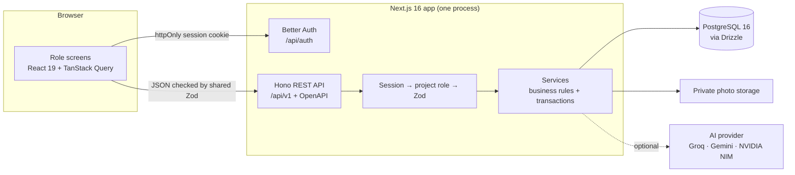

# Slate: every detail is accounted for

Slate is a construction-site tracker for small builders and house owners, built by team SixSeven for
Avishkar 2K26 (Full Stack Development, problem statement 21). It replaces the site notebook with one
shared record of the work. It covers what material arrived and what was used, who worked and what
they are owed, what changed on site, and where the money went. Every entry is checked on the server,
and a mistake is corrected by a logged fix, never by changing the past.

## The problem

Most home construction still runs on notebooks and verbal agreements. The contractor, the owner and
the workers each keep their own version of what arrived, what was used, who worked and who was paid.
Material goes missing between delivery and use, wages get disputed, and the owner pays for numbers
nobody can check. A common fraud pattern: the contractor buys genuine material, shows the owner the
real bill, resells the stock and builds with something cheaper.

## What Slate does

Three roles share one project. Each sees only what their job needs.

| Role | Main screens | What they do |
|---|---|---|
| **Site engineer** | Home, Logs, Site, Stock · **Review** | Starts the project, imports Revit quantities (.xlsx), writes the checklist, invites the team. Verifies deliveries and bag codes, reviews task photos, uploads steel-marking photos. Sees no wage amounts. |
| **Contractor** | Today, Stock, Site, Wages · **Log** | Logs deliveries, material usage and attendance from a phone. Works checklist tasks with photo proof. Pays wages and manages workers. |
| **Owner** | Home, Logs, Site, Money · **Approvals** | Sees spend against budget and spend over time. Approves changes with a note. Manages suppliers, orders and (mock) supplier payments, and reviews flags. |

Features in this build:

- **Stock ledger.** Deliveries and usage are append-only stock movements. The balance can never go
  negative, and over-use is refused with a 409. A supplier challan number can only be used once per
  project.
- **Bag codes.** A material can opt in to tracked bags. The engineer registers one code per bag on
  delivery, and each code can be used only once, for that material in that project.
- **Attendance and wages.** Half-day attendance, the worker's rate copied onto each entry, and wages
  calculated on the server in integer paise. The wage sheet exports to PDF and CSV, and the CSV
  export neutralises spreadsheet formulas.
- **Corrections, not edits.** Database triggers block changes to past rows. A fix appends an
  adjustment with a reason, the actor and the old and new values, so the original stays on record.
- **Two-step approvals.** Checklist changes, attendance corrections and medical claims go to a vote:
  the engineer asks, the contractor votes, and the owner makes the final call. An accepted change is
  applied once, in the same transaction.
- **Checklist with proof.** The contractor starts a task and submits a note with photos, and the
  engineer accepts it or sends it back. Tasks marked for steel need photos of the steel markings
  (brand, BIS mark, MTC number) before the engineer can accept them.
- **Supplier payments (mock).** Only the owner approves suppliers, orders and payments. A payment
  goes only to an approved supplier, for an engineer-verified delivery, within the approved order.
  A bank-detail change holds payments until the owner confirms it and a 24-hour cooldown ends.
- **Owner review flags.** Flags appear for new suppliers, pending bank changes, deliveries left
  unverified for two days, unit prices above 125% of recent deliveries, repeated reschedules, and
  paid receipts missing verification.
- **Ask Slate.** An optional AI assistant for construction questions, with server-side concrete and
  brick-wall quantity calculators. It has read-only access and never sees supplier or medical data.
  The checklist can be drafted by AI, and falls back to a labelled template when no AI provider is
  configured.

Slate never holds or moves money. Supplier payments and medical reimbursements use a mock provider
with synthetic account data, and the UI labels them as mock. Registered bag codes and photos record
what people reported. They don't prove what is inside a bag. Collusion between a contractor and an
engineer is not prevented, only made visible through flags and the audit trail.

## Architecture

One Next.js app serves both the screens and the API. A single set of Zod schemas defines every
request and response, and both the browser and the server use it.



How one save travels, using a delivery as the example:

1. The contractor's **Today** screen calls a TanStack Query hook, which sends JSON through the API client
   to `POST /api/v1/projects/{id}/deliveries`.
2. The Hono route checks the session, then the caller's role in that project. A project you aren't
   in returns 404, and the wrong role returns 403. The body is validated against the shared Zod
   schema.
3. The service writes the stock movement, the cached balance and the audit entry in **one PostgreSQL
   transaction**. Database CHECK constraints and triggers enforce the rules a second time.
4. The browser validates the response against the same schema and refreshes the affected lists.
   Other people's open screens catch up within 10 seconds.

### Data integrity rules

| Rule | How it is enforced |
|---|---|
| Stock never goes negative | Guarded `UPDATE … WHERE balance >= qty` plus a CHECK constraint; over-use returns 409 |
| History can't be rewritten | Append-only tables protected by database triggers; corrections are new adjustment rows with a reason |
| Money is exact | Integer paise (`bigint`) everywhere, never floats |
| Each role sees its own data | `project_members` roles checked on every route; engineers get no wage breakdown |
| Concurrent saves stay consistent | Transactions and row locks on stock, attendance and payments |
| One error shape | `{ "error": { "code", "message", "details"? } }` for every failure |

These are database guarantees, not cryptographic tamper evidence.

### Tech stack

| Layer | Choice |
|---|---|
| App | Next.js 16.4 (App Router), React 19.3, TypeScript 5 |
| API | Hono 4 at `/api/v1`, `@hono/zod-openapi` (live spec at `/api/v1/doc`) |
| Contract | Zod 4 schemas in `src/shared/schemas`, shared by browser and server |
| Database | PostgreSQL 16, Drizzle ORM and drizzle-kit migrations, `postgres` driver |
| Sign-in | Better Auth (email and password, invite-only sign-up, httpOnly session cookie) |
| UI | Tailwind CSS 4, shadcn/ui on Radix, lucide icons, Recharts, sonner, next-themes |
| Files | sharp (validates uploaded photos), PDFKit (wage sheet), fflate (Revit .xlsx import in the browser) |
| AI | Vercel AI SDK 7: Groq, Gemini, NVIDIA NIM or any HTTPS OpenAI-compatible endpoint |
| Quality | Biome 2, Vitest 5 (unit and PostgreSQL-backed API tests), Playwright, GitHub Actions CI |
| Running | pnpm 12 via Corepack, Docker Compose for PostgreSQL, Cloudflare quick tunnel for sharing |

### Code layout

```text
src/
  app/              Next.js routes: /login, /projects, /projects/[id]/{logs,site,money,stock,wages,team}
    api/[[...route]]/  hands every /api/v1 request to the Hono app
  components/       screens by area (today, stock, wages, owner, money, engineer, site, payments, …)
  hooks/            TanStack Query hooks for every API read and write
  lib/              browser-safe helpers: API client, formatting, Revit parser
  shared/schemas/   the API contract (Zod)
  server/
    routes/         one Hono module per resource: validate, authorise, call a service
    services/       business rules, transactions, queries
    middleware/     session check and error format
    ai/             Ask Slate, checklist drafts, quantity calculators
  db/               schema.ts, SQL migrations, demo seed
tests/api/          API tests against a throwaway PostgreSQL
tests/e2e/          Playwright browser tests
docs/               specification, API contract, handbook, ledgers
```

## Run it

You need Node 24 with Corepack and a running Docker Engine (Docker Desktop on Windows).

```bash
./start.sh            # Linux, macOS or WSL: live mode on http://localhost:3000
./start.sh --seed     # same, and (re)apply the demo data
```

```powershell
.\start.ps1 -Live     # Windows PowerShell 7.2+
.\stop.ps1            # from a second terminal
```

The launcher creates `.env` with random local secrets the first time, starts PostgreSQL, installs
packages from the lockfile, applies migrations, seeds a fresh database and starts the app. Sign in
as `owner@demo.invalid`, `contractor@demo.invalid` or `engineer@demo.invalid` with the
`SLATE_DEMO_PASSWORD` from your `.env`. Ctrl+C stops the app and leaves the database running.

Ask Slate is optional: set `AI_PROVIDER`, `AI_MODEL` and `AI_API_KEY` in `.env` to enable it.
Without them the assistant shows an offline state, and everything else still works.

Manual setup, resetting the demo data, sharing over a Cloudflare tunnel, troubleshooting and every
endpoint's inputs and outputs are in the **[dev handbook](docs/HANDBOOK.md)**. Step-by-step demo
walkthroughs are in [DEMO.md](docs/DEMO.md).

## Checks

```bash
pnpm lint        # Biome, no writes
pnpm typecheck
pnpm test        # Vitest; the API tests need a disposable loopback database named slate_test…
pnpm test:e2e    # Playwright
```

Don't use `pnpm lint:fix` as a check: it rewrites files.

## Known limits (hackathon build)

- Payments are mock. A real build would use a licensed gateway (escrow or a UPI mandate), and only
  after a legal check.
- Invite sign-up doesn't verify email ownership yet. Anyone who knows an invited address can claim
  it first. A public build needs emailed tokens and rate limiting.
- Phone invitations can't grant access until phone verification exists.
- Revit `.rvt` files are not read. Only the `.xlsx` quantity export is imported.
- See [DISCLOSURES.md](docs/DISCLOSURES.md) for AI, dependency and data disclosures.

## Docs

| File | What |
|---|---|
| [SPECIFICATION.md](docs/SPECIFICATION.md) | Product and integrity rules |
| [API.md](docs/API.md) | API contract: every route, who may call it, status |
| [HANDBOOK.md](docs/HANDBOOK.md) | Run, share, fix, screens, code map, every endpoint |
| [ARCHITECTURE.md](docs/ARCHITECTURE.md) | Release architecture notes |
| [DEMO.md](docs/DEMO.md) | Demo walkthroughs |
| [DECISIONS.md](docs/DECISIONS.md) | Decision log |
| [PROJECT_LEDGER.md](docs/PROJECT_LEDGER.md), [BACKEND_LEDGER.md](docs/BACKEND_LEDGER.md), [FRONTEND_LEDGER.md](docs/FRONTEND_LEDGER.md) | Milestones and verification records |

Contributors: [AGENTS.md](AGENTS.md) holds the canonical project rules.

## Dependency licenses

Declared licenses of direct dependencies (not independently audited).

| Package | Declared licence | Use |
|---|---|---|
| @ai-sdk/google | Apache-2.0 | runtime |
| @ai-sdk/groq | Apache-2.0 | runtime |
| @ai-sdk/openai-compatible | Apache-2.0 | runtime |
| @hono/zod-openapi | MIT | runtime |
| @tanstack/react-query | MIT | runtime |
| ai | Apache-2.0 | runtime |
| better-auth | MIT | runtime |
| class-variance-authority | Apache-2.0 | runtime |
| cn | MIT | runtime |
| drizzle-orm | Apache-2.0 | runtime |
| fflate | MIT | runtime |
| hono | MIT | runtime |
| lucide-react | ISC | runtime |
| next | MIT | runtime |
| next-themes | MIT | runtime |
| pdfkit | MIT | runtime |
| postgres | Unlicense | runtime |
| radix-ui | MIT | runtime |
| react | MIT | runtime |
| react-dom | MIT | runtime |
| recharts | MIT | runtime |
| shadcn | MIT | runtime |
| sharp | Apache-2.0 | runtime |
| sonner | MIT | runtime |
| tw-animate-css | MIT | runtime |
| zod | MIT | runtime |
| @biomejs/biome | MIT OR Apache-2.0 | dev |
| @faker-js/faker | MIT | dev |
| @playwright/test | Apache-2.0 | dev |
| @tailwindcss/turbopack | MIT | dev |
| @types/node | MIT | dev |
| @types/pdfkit | MIT | dev |
| @types/react | MIT | dev |
| @types/react-dom | MIT | dev |
| drizzle-kit | MIT | dev |
| tailwindcss | MIT | dev |
| tsx | MIT | dev |
| typescript | Apache-2.0 | dev |
| vitest | MIT | dev |

## License

MIT, see [LICENSE](LICENSE).
