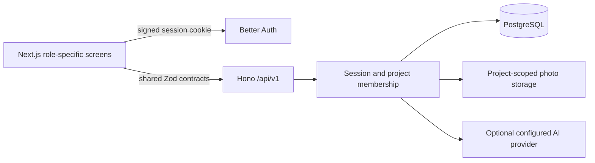

# Slate release architecture

The browser sends inputs and refreshes queries after writes. The server resolves the actor and project role. Stock updates, bag consumption and audit events commit together. Registered bag codes and photos record what people observed; they cannot independently establish material authenticity.

Attendance changes pass through contractor and owner decisions as applicable. Decisions append events, with row locks preventing repeated application. Wage reports use effective attendance and exact integer paise. Accepted medical claims produce mock reimbursements bounded by the claim. Selected checklists require steel evidence tied to the current completion submission.

Engineers verify deliveries. Owner-approved supplier orders, mandate caps, bank-change cooldowns and payment controls determine eligibility inside PostgreSQL transactions. Supplier payments are mock receipts only. Sensitive supplier and medical data stay outside the AI context.

Ask Slate sends only project name, location and role alongside bounded conversation turns. It does not mutate project data. Missing provider configuration returns an explicit offline state. The separate concrete estimate uses fixed volume conversions and explicit mix and wastage inputs.
