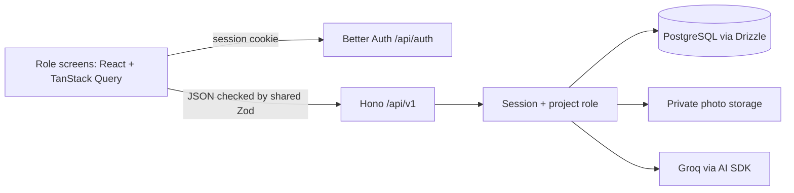

# Slate dev handbook

Everything needed to run, inspect, demo and share Slate, plus every API input and output. No secrets
live here: real values stay in your ignored `.env`.

## 1. Tech stack and why

One TypeScript codebase: the screens, the API and the database code live in one Next.js app, and one
set of Zod schemas describes every request and response on both sides.



| Layer | What we use | Why |
|---|---|---|
| App framework | Next.js 16.4 (App Router), React 19.3 | One app and one deploy serves both the screens and the API. Each role's pages are plain folders under `src/app/projects/[id]`. |
| API | Hono 4 mounted at `/api/v1`, `@hono/zod-openapi` | A small, fast router with middleware for sign-in and project-role checks. Routes are declared with Zod, which validates input and publishes the OpenAPI document at `/api/v1/doc` (this handbook's endpoint list comes from it). |
| Contract | Zod 4 in `src/shared/schemas` | The browser and server import the same schemas. The frontend parses every response with them, so a mismatch fails loudly instead of showing wrong numbers. |
| Database | PostgreSQL 16 in Docker | Transactions and row locks keep stock, wages and payments consistent when two people save at once. Money is integer paise; ledgers are append-only and corrected by adjustments. |
| Data access | Drizzle ORM 0.45, drizzle-kit, `postgres` driver | Typed queries that stay close to SQL, reviewable SQL migrations in `src/db/migrations`, and Drizzle Studio to browse the data. |
| Sign-in | Better Auth 1.7 | Email and password with an httpOnly session cookie, stored in the same database. Open sign-up is off; only invited emails can create accounts. |
| Server data in the UI | TanStack Query 5 | Caches each project's data, refreshes it after every save and every 10 s, so one person's change reaches everyone's open screen. |
| UI | Tailwind CSS 4, shadcn on Radix UI, lucide icons, sonner toasts, next-themes | Accessible building blocks (sheets, dialogs, focus handling) styled with our own light and dark tokens. Type is Newsreader for headings and Geist for text. |
| Charts | Recharts 3 | The stock and spend area charts. |
| AI | Vercel AI SDK 7 with Groq (`openai/gpt-oss-120b`) | One API for several providers (Groq, Gemini, NVIDIA, any OpenAI-compatible endpoint), switched by `.env`. Groq answers in about a second. |
| Revit import | fflate | An .xlsx is a zip of XML files, so a tiny unzip library reads it in the browser; no large spreadsheet package. |
| Files | sharp, pdfkit | sharp checks and decodes uploaded photos on the server; pdfkit renders the wage sheet PDF. |
| Quality | TypeScript 5, Biome 2, Vitest 5, Playwright | Types across the stack; Biome lints and formats in one fast tool; Vitest runs unit tests and API tests against a throwaway database; Playwright drives real browsers. |
| Tooling | pnpm 12 via Corepack, Node 22 or newer, tsx | Pinned package manager and a strict lockfile, so every laptop installs the same versions. tsx runs TypeScript scripts such as the seed. |
| Running and sharing | Docker Compose, cloudflared | One command starts PostgreSQL. A Cloudflare quick tunnel shares a running copy with other laptops without deploying or opening ports. |

## 2. Start, stop and reset

**What runs where**

| Piece | Port | What it is |
|---|---|---|
| PostgreSQL 16 | 5432 (loopback only) | Docker container `slate-db-1`; its data lives in `.cache/postgres`, so it survives restarts |
| Slate dev server | 3000 | `next dev`: the screens and the API (`/api/v1`) in one process, reloads on code changes |
| Shared production server | 3100 | Only while `./share.sh` runs: a production build behind a Cloudflare tunnel (section 3) |
| Drizzle Studio | 4983 | Only while `pnpm db:studio` runs; open https://local.drizzle.studio |

**Start (one command).** Linux, macOS or WSL: `./start.sh`. Windows PowerShell 7: `.\start.ps1`.

```bash
./start.sh            # live mode on http://localhost:3000
./start.sh --seed     # same, and (re)apply the demo data
```

In order, it:
1. Checks Node 24, Corepack and a running Docker Engine.
2. Creates `.env` with random local secrets the first time.
3. Starts the PostgreSQL container if it isn't already running.
4. Installs packages from the lockfile.
5. Applies any pending migrations.
6. Seeds the demo data when the database is brand new (or with `--seed`).
7. Starts the dev server in that terminal.

It stops early with a plain message if a port is taken or `.env` doesn't match the local database.

**Stop.**
- The app: Ctrl+C in the terminal running `./start.sh` (Windows: `.\stop.ps1`).
- PostgreSQL keeps running, which is fine. To stop it as well: `docker compose stop db`. Data stays in `.cache/postgres`.
- `docker compose down` removes the container but keeps the data. Never delete `.cache/postgres` unless you mean to wipe everything.

**Manual start** (same result, step by step):

```bash
corepack pnpm install --frozen-lockfile
cp .env.example .env            # then fill in the values (section 6)
docker compose up -d db         # local PostgreSQL (container slate-db-1)
SLATE_MIGRATION_DATABASE=slate_demo pnpm db:migrate
pnpm db:seed                    # demo accounts and the Greenfield Home project
pnpm dev                        # http://localhost:3000
```

**Reset to just the demo data** (wipes every project, account and photo people created):

```bash
# 1. stop the app (Ctrl+C), then:
docker exec slate-db-1 psql -U slate -d postgres -c "drop database slate_demo with (force)" -c "create database slate_demo"
mv .cache/uploads .cache/uploads-old      # uploaded photos; delete later
./start.sh                                # empty database: migrates and seeds by itself
```

Back up first if you might want the data: `docker exec slate-db-1 pg_dump -U slate -Fc slate_demo > .cache/slate_demo.dump`. Every login session goes with the reset, so everyone signs in again.

| Command | Does |
|---|---|
| `pnpm dev` | Dev server on :3000 (`pnpm dev:lan` listens on your LAN too) |
| `pnpm build` / `pnpm start` | Production build / serve it |
| `pnpm lint` · `pnpm typecheck` · `pnpm test` | Biome, TypeScript, Vitest |
| `pnpm db:migrate` | Apply `src/db/migrations` (needs `SLATE_MIGRATION_DATABASE` = the database name in `DATABASE_URL`) |
| `pnpm db:generate` | New migration from `src/db/schema.ts` changes |
| `pnpm db:seed` | Demo data (idempotent; needs `SLATE_DEMO_SEED=1`) |
| `pnpm db:studio` | Drizzle Studio (section 10) |
| `./share.sh` | Share over a Cloudflare tunnel (section 3) |

API tests (`tests/api`) need `SLATE_TEST_DATABASE=1` and a loopback database named `slate_test…`; CI provides one.

## 3. Share with other laptops (Cloudflare tunnel)

```bash
./share.sh            # add --build after code changes
./share.sh --port 3200
```

How it works, step by step:
1. **Build.** It runs `pnpm build` if there is no production build yet, or when you pass `--build`. Without `--build` it serves the old build, so after any code change always pass it.
2. **Tunnel.** It starts `cloudflared tunnel --url http://localhost:3100`, a free Cloudflare *quick tunnel*: a public `https://….trycloudflare.com` address that forwards to your laptop, with no account, no deploy and no open ports.
3. **Address.** It waits up to 60 s for Cloudflare to hand out the address and prints it.
4. **Sign-in origin.** Sign-in only accepts requests from `BETTER_AUTH_URL`. So for this run it sets `BETTER_AUTH_URL` to the tunnel address and starts `next start` on :3100.

Rules of thumb:
- Sign in on the tunnel address, not `localhost:3100`.
- **Ctrl+C** stops the server and the tunnel together.
- The address changes every run, so send the new link each time.
- It uses the same local database as the dev server: everyone sees the same data, and your laptop must stay on and online.
- The link is public. Anyone who has it can reach the sign-in page.
- The dev server on :3000 keeps working alongside it. Run `--build` **before** starting the dev server, or restart the dev server after the build (section 4).

Install `cloudflared` once (no sudo):

```bash
curl -L -o ~/.local/bin/cloudflared https://github.com/cloudflare/cloudflared/releases/latest/download/cloudflared-linux-amd64
chmod +x ~/.local/bin/cloudflared
```

To run Slate *on* another laptop instead, clone the repo there and follow section 2 with its own
`.env` and database.

## 4. When something breaks

| You see | Why | Fix |
|---|---|---|
| localhost keeps reloading by itself | A production build ran while the dev server was starting; the dev server keeps sending `HMR hash mismatch` | Stop the dev server (Ctrl+C) and start it again |
| "Sign in to see your projects" after a reset | The reset wiped every login session | Sign in again |
| Sign-in fails on the shared link | Signing in on `localhost:3100`, or an old tunnel address | Use the address `share.sh` printed this run |
| `Port 3000 is unavailable` | Another dev server is already running | Use the running one, or stop it first |
| `PostgreSQL did not become healthy` | Docker isn't running, or port 5432 is taken | Start Docker; check `docker ps` |
| Ask Slate says it's offline | No `AI_MODEL` or `AI_API_KEY` in `.env` | Add them (section 11) and restart the server |
| Demo password stopped working | `SLATE_DEMO_PASSWORD` changed in `.env` | Restart the server or run `pnpm db:seed`; the accounts follow `.env` |
| Drizzle Studio won't open | Studio isn't running | `pnpm db:studio`, then https://local.drizzle.studio |

## 5. Questions people ask

**What is it built with, and why one app?**
- It's one Next.js app that serves both the screens and the API (Hono at `/api/v1`), on PostgreSQL through Drizzle.
- One codebase and one deploy.
- The same Zod schemas check every request on the server and every response in the browser, so the two sides cannot drift apart silently.

**How does login work?**
- Better Auth with email and password. The session is an httpOnly cookie that page scripts cannot read.
- Open sign-up is off: you can only create an account for an email that has a pending invitation.
- Sign-in requests must come from the app's own origin.

**How are roles enforced?**
- On the server, on every request: the API looks up your membership for that project and its role.
- A project you're not in returns 404, so its existence isn't revealed. A wrong role returns 403. Missing login returns 401.
- The screens only hide buttons; the server is the real gate.

**Who can do what?**
- Engineers start projects, invite people (including more engineers), set up materials and checklists, verify deliveries and review work.
- Contractors log deliveries, usage, attendance and wages.
- Owners watch spending and approve changes and payments.
- A project can have several engineers with equal rights. Any engineer can revoke an invite or remove a member, but never themselves.

**How do you stop a contractor faking records?** The main defences:
- Stock and audit records are append-only: the database rejects edits and deletes. A mistake is fixed with an adjustment that keeps the old value and a reason.
- The engineer confirms deliveries; bag codes can be registered so each bag is used once.
- Progress photos must carry a capture time no more than 10 minutes before upload.
- The owner gets fraud flags: new supplier, bank-detail change, a delivery not confirmed in 2 days, an unusual price, a payment without a verified delivery, repeated delays.
- Contractor and engineer collusion is made visible through flags and the audit trail, not prevented. We don't claim fraud is impossible.

**How is money handled?**
- Every amount is an integer number of paise, so there are no rounding errors.
- The server calculates payment amounts and caps them at the owner's approved order.
- Slate never holds money: payments use a mock provider that is labelled as a mock. A real build would use a licensed gateway.

**What if two people save at the same time?**
- Related writes run in one database transaction, with row locks where it matters. Using stock and consuming bag codes, for example, commit together or not at all.
- Database constraints back this up: a unique challan number per supplier, foreign keys, and checks on money and quantities.

**How do other people's changes show up?**
- Every screen refreshes its data every 10 s and right after each save.
- It's plain polling, chosen because it's simple and works through the tunnel. No WebSockets.

**What does the AI do?**
- Ask Slate answers short construction questions using Groq through the Vercel AI SDK.
- Concrete and brick quantities come from fixed formulas on the server; the model only explains the numbers.
- It can't see project records and turns down off-topic questions. It's limited to 10 questions per minute, and without a key it says it's offline.
- Checklists can be drafted by AI and fall back to a template.
- It is not engineering sign-off.

**Where do photos go?**
- In a private folder on the server (`UPLOAD_DIR`), never a public bucket.
- They're served only to project members. sharp checks each file is a real image.

**How does the Revit import work?**
- The engineer exports quantities from Revit as .xlsx, and the browser reads it with fflate (an .xlsx is a zip of XML files).
- It makes one material per category and unit. The .rvt file itself is not read.

**How is it tested?**
- TypeScript across the stack, Biome for lint and format, and Vitest for unit tests.
- API tests run against a throwaway PostgreSQL in CI; Playwright drives real browsers.

**Where's the API documentation?**
- `GET /api/v1/doc` returns the OpenAPI document, generated from the same Zod schemas.
- Section 13 lists every endpoint.

**Can it go to production?**
- The Dockerfile builds a standalone Node server, so it runs on any Node host with a managed PostgreSQL.
- Today it runs on a laptop and is shared through a tunnel.
- A real launch would still need verified phone sign-in, a real payment gateway, backups and hardening.

**Does it work offline?** No. It needs a connection to the server.

**Phone invites?** Stored, but they can't be redeemed until phone sign-in with verification exists.

## 6. Settings (`.env`)

| Variable | What |
|---|---|
| `DATABASE_URL` | `postgres://slate:<password>@127.0.0.1:5432/slate_demo` |
| `POSTGRES_PASSWORD`, `POSTGRES_DB`, `DB_PORT` | Compose database |
| `SLATE_MIGRATION_DATABASE` | Must equal the database name before `db:migrate` runs |
| `BETTER_AUTH_SECRET` | `openssl rand -base64 32` |
| `BETTER_AUTH_URL` | The one origin sign-in accepts, e.g. `http://localhost:3000`. `share.sh` swaps it for the tunnel address |
| `SLATE_DEMO_SEED`, `SLATE_DEMO_PASSWORD` | Seed switch and the demo accounts' password (8–64 characters). Change it and restart the server (or run `pnpm db:seed`): the demo accounts follow it |
| `UPLOAD_DIR` | Private folder for uploaded photos |
| `NEXT_PUBLIC_USE_MOCKS` | `0` = live database, `1` = in-browser demo data (dev only) |
| `AI_PROVIDER`, `AI_MODEL`, `AI_API_KEY`, `AI_BASE_URL` | Ask Slate and AI checklists (section 11) |

## 7. Accounts, roles and screens

Demo accounts: `owner@demo.invalid`, `contractor@demo.invalid`, `engineer@demo.invalid`; password is
`SLATE_DEMO_PASSWORD`. New people join by invitation: any engineer invites an email on **Team** as
owner, contractor or another site engineer; the person picks **Invited? Create your account** on
`/login`, signs up, then accepts or declines on **Projects**. A project can have several engineers with
the same rights. On **Team** an engineer can revoke an invite nobody has accepted yet, or remove anyone
except themselves. A removed person loses access at once, keeps their name on what they already logged,
and can be invited back.

| Role | Sees and does |
|---|---|
| Engineer | The only role that starts projects; **Set up the project** on home (Revit .xlsx import, add material, write checklist); reviews tasks; verifies deliveries; on Team invites people (more engineers too), revokes waiting invites and removes people; no wage amounts |
| Contractor | **Today** (delivery, usage, attendance, Fix); **Stock**; **Wages** (pay, add/remove workers); works checklist tasks. Cannot start projects |
| Owner | Home (budget, spend, approvals with a note); **Money** (suppliers, orders, mock payments, autopay); **Logs**. Cannot start projects |

Walkthroughs for both demos (seeded project, new project) are in [DEMO.md](DEMO.md).

**Revit import format:** sheet 1, a header row `Category | Level | Type | Count | Quantity | Unit` in
columns A–F; rows without a category (titles, subtotals) are skipped. One material per category and
unit. The `.rvt` file itself is not read.

## 8. Screens and navigation

`/` sends you to `/projects`. Signed out, any page offers a link to `/login`.

| Route | Screen | Who |
|---|---|---|
| `/login` | Sign in; **Invited? Create your account** for invited emails | Everyone |
| `/projects` | Your projects, your invitations (Accept / Decline), **Start a project** | Everyone; Start only for engineers |
| `/projects/[id]` | Project home: Owner Home, Contractor **Today**, Engineer Home with **Set up the project** | Members |
| `/projects/[id]/logs` | Spends, stock movements, attendance, fixes (engineers see no money) | Owner, engineer |
| `/projects/[id]/site` | Work by phase, checklist tasks, changes, progress timeline | Everyone |
| `/projects/[id]/money` | Spending, wage sheet, suppliers, orders, mock payments, autopay | Owner |
| `/projects/[id]/stock` | Stock per material with charts | Contractor, engineer |
| `/projects/[id]/wages` | Wage sheet, record a payment, add or remove workers | Contractor |
| `/projects/[id]/team` | People with tap-to-call; engineers invite, revoke and remove | Members |
| `/styleguide` | Design tokens and components (development only) | Developers |

Each role gets four tabs and one centre button. They sit in the top bar on desktop and the bottom dock on a phone:

| Role | Tabs | Centre button |
|---|---|---|
| Owner | Home · Logs · Site · Money | **Approvals** |
| Contractor | Today · Stock · Site · Wages | **Log** (delivery, usage, attendance) |
| Engineer | Home · Logs · Site · Stock | **Review** (tasks and deliveries to check) |

Other ways around:
- The project name at the top switches projects and links to **Team** and **All projects and invitations**.
- The sparkle button opens **Ask Slate**.
- Your role is fixed per project, so switching to a project where you're the contractor switches to the contractor tabs.

## 9. Where the code lives

```text
src/
  app/                    Next.js routes (one folder per screen, section 8)
    api/[[...route]]/     hands every /api/v1 request to the Hono app
    api/auth/[...auth]/   Better Auth sign-in, sign-out and session
  components/             screens and parts, one folder per area:
    shell/                top bar, dock, project switcher, project list, role tabs (nav.ts)
    today/ stock/ wages/  contractor screens (Today forms, Fix sheet, stock charts, wages)
    owner/ money/ logs/   owner home, money page, logs page
    engineer/ site/       engineer home, project setup and Revit import, review, site and checklist
    team/ auth/           Team page, invitations, start a project, login form
    payments/ approvals/  suppliers, payments, delivery checks, change approvals
    photos/ assistant/    camera and photo proof, Ask Slate
    charts/ ui/ brand/    charts, shadcn building blocks, logo
  hooks/                  TanStack Query hooks: every API read and write the screens make
  lib/                    browser-safe helpers: API client, formatting, dates, Revit parser (boq.ts)
  shared/schemas/         the API contract: Zod schemas used by server and browser
  server/
    app.ts                the Hono app; mounts every route module
    routes/               one file per resource: validates input, calls a service
    services/             business rules, transactions and database queries
    middleware/           sign-in check (auth.ts) and the error format (errors.ts)
    ai/                   Ask Slate, checklist drafts, the quantity calculators
  db/
    schema.ts             every table (auth tables in auth-schema.ts)
    migrations/           SQL migrations, applied in order
    seed.ts               demo accounts and projects
  mocks/                  in-browser demo data for NEXT_PUBLIC_USE_MOCKS=1
tests/api/                API tests against a throwaway PostgreSQL
tests/e2e/                Playwright browser tests
docs/                     specification, API table, ledgers, this handbook
```

How one save travels, using a delivery as the example:
1. The **screen** (`components/today/today-page.tsx`) calls a **hook** (`hooks/use-project-data.ts`).
2. The hook sends JSON through `lib/api/client.ts` to `POST /api/v1/projects/{id}/deliveries`.
3. The **route** (`server/routes/deliveries.ts`) checks the body against the shared **schema** (`shared/schemas/deliveries.ts`).
4. The route calls the **service** (`server/services/stock-ledger.ts`). The service checks your membership and role, then writes the delivery and the audit entry in one transaction through Drizzle.
5. The response is checked against the same schema in the browser. The hook then refreshes the affected lists, and other people's screens catch up within 10 s.

To add a feature, work in this order:
1. Schema in `src/shared/schemas`.
2. A migration, if the database changes.
3. The service.
4. The route.
5. A hook.
6. The screen.
7. Tests for each layer.

## 10. Database

- **Drizzle Studio:** `pnpm db:studio`, then open <https://local.drizzle.studio>. It reads `DATABASE_URL`
  from `.env`; browse and edit every table. Close it with Ctrl+C.
- **psql:** `docker exec -it slate-db-1 psql -U slate -d slate_demo`
  - `\dt` lists tables; `select count(*) from projects;`
  - row counts: `select relname, n_live_tup from pg_stat_user_tables order by 1;`
- Schema: `src/db/schema.ts` (app) and `src/db/auth-schema.ts` (Better Auth: user, session, account).
- Money is integer **paise**; quantities have at most 3 decimals; dates are IST `YYYY-MM-DD`.
- Ledgers are append-only: fix a wrong entry with an adjustment (`POST /projects/{id}/adjustments`), never an edit.

## 11. AI (Ask Slate, checklists)

`.env`: `AI_PROVIDER=groq`, `AI_MODEL=openai/gpt-oss-120b`, `AI_API_KEY=<your Groq key>`. Without
`AI_MODEL` or the key, Ask Slate replies `{ "source": "offline" }` and checklists use the template.
List the models your key can use:

```bash
curl -s https://api.groq.com/openai/v1/models -H "Authorization: Bearer $AI_API_KEY"
```

Ask Slate answers in under about 80 words and declines anything off-topic. It cannot see project
records and points to the right screen instead. Concrete and brick-wall quantities come from two
deterministic server calculators (`src/server/ai/calculations.ts`: dry-volume factor 1.54 for
concrete, 1.33 for mortar, 50 kg bag = 0.035 m³); the model only reports their numbers. Limits: 10
questions per user per minute, 20 s timeout. Answers are not engineering sign-off.

## 12. API conventions

- Base: `/api/v1`. Auth: Better Auth at `/api/auth` (`POST /api/auth/sign-in/email` with
  `{ email, password }`, `POST /api/auth/sign-out`). Sessions are an httpOnly cookie; send an `Origin`
  header equal to `BETTER_AUTH_URL` on auth calls.
- Every error: `{ "error": { "code", "message", "details"? } }`. Codes: `VALIDATION_ERROR` (400),
  `UNAUTHENTICATED` (401), `FORBIDDEN` (403), `NOT_FOUND` (404, also for projects you are not in),
  `CONFLICT` (409), `INSUFFICIENT_STOCK`, `DUPLICATE_CHALLAN`, `INTERNAL`.
- Who may call each route: the table in [API.md](API.md). Live OpenAPI JSON: `GET /api/v1/doc`.
- `?` marks an optional field. Regenerate the reference below after API changes:
  `curl -s localhost:3000/api/v1/doc > /tmp/openapi.json && python3 scripts/api-reference.py /tmp/openapi.json`

### Quick try

```bash
B=http://localhost:3000
curl -c jar -H "origin: $B" -H 'content-type: application/json' \
  -d '{"email":"owner@demo.invalid","password":"<SLATE_DEMO_PASSWORD>"}' $B/api/auth/sign-in/email
curl -b jar $B/api/v1/projects
```

## 13. Every endpoint: inputs and outputs

#### `POST /invitations/signup`
- **Body** (JSON): { email: string, name: string, password: string }
- **201**: { created: `true` }
- **Errors:** 400, 409, 500

#### `POST /projects`
- **Body** (JSON): { name: string, location: string, startDate: string, budgetPaise: integer }
- **201**: { id: string, name: string, location: string, startDate: string, budgetPaise: integer, role: `owner` \| `contractor` \| `engineer` }
- **Errors:** 400, 401, 403, 404, 500

#### `GET /projects`
- **200**: array of { id: string, name: string, location: string, startDate: string, budgetPaise: integer, role: `owner` \| `contractor` \| `engineer` }
- **Errors:** 400, 401, 403, 404, 500

#### `GET /projects/{id}`
- **200**: { id: string, name: string, location: string, startDate: string, budgetPaise: integer, role: `owner` \| `contractor` \| `engineer` }
- **Errors:** 400, 401, 403, 404, 500

#### `POST /projects/{id}/members`
- **Body** (JSON): { email: string, role: `owner` \| `engineer` }
- **201**: { userId: string, role: `owner` \| `contractor` \| `engineer` }
- **Errors:** 400, 401, 403, 404, 409, 500

#### `GET /projects/{id}/members`
- **200**: array of { userId: string, role: `owner` \| `contractor` \| `engineer`, name: string, phone?: string, isMe: boolean }
- **Errors:** 400, 401, 403, 404, 500

#### `POST /projects/{id}/invitations`
- **Body** (JSON): { email: string, role: `owner` \| `contractor` \| `engineer` } **or** { phone: string, role: `owner` \| `contractor` \| `engineer` }
- **201**: { id: string, projectId: string, projectName: string, role: `owner` \| `contractor` \| `engineer`, createdAt: string, status: `pending` \| `accepted`, email: string } **or** { id: string, projectId: string, projectName: string, role: `owner` \| `contractor` \| `engineer`, createdAt: string, status: `pending` \| `accepted`, phone: string }
- **Errors:** 400, 401, 403, 404, 409, 500

#### `GET /projects/{id}/invitations`
- **Query:** status?: `pending` \| `accepted`
- **200**: array of { id: string, projectId: string, projectName: string, role: `owner` \| `contractor` \| `engineer`, createdAt: string, status: `pending` \| `accepted`, email: string } **or** { id: string, projectId: string, projectName: string, role: `owner` \| `contractor` \| `engineer`, createdAt: string, status: `pending` \| `accepted`, phone: string }
- **Errors:** 400, 401, 403, 404, 500

#### `GET /invitations`
- **200**: array of { id: string, projectId: string, projectName: string, role: `owner` \| `contractor` \| `engineer`, createdAt: string, status: `pending` \| `accepted`, email: string } **or** { id: string, projectId: string, projectName: string, role: `owner` \| `contractor` \| `engineer`, createdAt: string, status: `pending` \| `accepted`, phone: string }
- **Errors:** 400, 401, 403, 404, 500

#### `POST /invitations/{id}/accept`
- **200**: { userId: string, role: `owner` \| `contractor` \| `engineer` }
- **Errors:** 400, 401, 403, 404, 409, 500

#### `POST /invitations/{id}/decline`
- **200**: { id: string, outcome: `declined` \| `revoked` }
- **Errors:** 400, 401, 403, 404, 409, 500

#### `DELETE /projects/{id}/invitations/{invitationId}`
- **200**: { id: string, outcome: `declined` \| `revoked` }
- **Errors:** 400, 401, 403, 404, 409, 500

#### `DELETE /projects/{id}/members/{userId}`
- **200**: { userId: string, role: `owner` \| `contractor` \| `engineer`, removedAt: string }
- **Errors:** 400, 401, 403, 404, 409, 500

#### `GET /me/permissions`
- **200**: { canCreateProjects: boolean }
- **Errors:** 400, 401, 403, 404, 500

#### `PATCH /me`
- **Body** (JSON): { phone: string }
- **200**: { phone: string }
- **Errors:** 400, 401, 403, 404, 500

#### `POST /projects/{id}/materials`
- **Body** (JSON): { name: string, unit: string, plannedQty: number, unitCostPaise: integer, tolerancePct: number, lowStockQty: number, tracksBags?: boolean }
- **201**: { id: string, name: string, unit: string, plannedQty: number, unitCostPaise: integer, tolerancePct: number, lowStockQty: number, tracksBags?: boolean }
- **Errors:** 400, 401, 403, 404, 500

#### `GET /projects/{id}/materials`
- **200**: array of { id: string, name: string, unit: string, plannedQty: number, unitCostPaise: integer, tolerancePct: number, lowStockQty: number, tracksBags?: boolean }
- **Errors:** 400, 401, 403, 404, 500

#### `POST /projects/{id}/workers`
- **Body** (JSON): { name: string, category: string, dailyRatePaise: integer }
- **201**: { id: string, name: string, category: string, dailyRatePaise: integer, active: boolean, removedReason?: string, removedOn?: string }
- **Errors:** 400, 401, 403, 404, 500

#### `GET /projects/{id}/workers`
- **200**: array of { id: string, name: string, category: string, dailyRatePaise: integer, active: boolean, removedReason?: string, removedOn?: string }
- **Errors:** 400, 401, 403, 404, 500

#### `POST /projects/{id}/workers/{workerId}/deactivate`
- **Body** (JSON): { reason: string }
- **200**: { id: string, name: string, category: string, dailyRatePaise: integer, active: boolean, removedReason?: string, removedOn?: string }
- **Errors:** 400, 401, 403, 404, 409, 500

#### `POST /projects/{id}/deliveries`
- **Body** (JSON): { materialId: string, qty: number, unitCostPaise: integer, supplier: string, challanNo: string, occurredOn: string, note: string }
- **201**: { id: string, materialId: string, qty: number, unitCostPaise: integer, supplier: string, challanNo: string, occurredOn: string, note: string, balance: number }
- **Errors:** 400, 401, 403, 404, 409, 500

#### `POST /projects/{id}/expected-deliveries`
- **Body** (JSON): { materialId: string, qty: number, supplier: string, expectedOn: string, note?: string }
- **201**: { materialId: string, qty: number, supplier: string, expectedOn: string, note: string, id: string, status: `pending` \| `accepted` \| `rejected`, deliveryId: string, rejectionReason: string, rescheduledOn: string, decidedAt: string, createdAt: string }
- **Errors:** 400, 401, 403, 404, 500

#### `GET /projects/{id}/expected-deliveries`
- **Query:** status?: `pending` \| `accepted` \| `rejected` or `all`
- **200**: array of { materialId: string, qty: number, supplier: string, expectedOn: string, note: string, id: string, status: `pending` \| `accepted` \| `rejected`, deliveryId: string, rejectionReason: string, rescheduledOn: string, decidedAt: string, createdAt: string }
- **Errors:** 400, 401, 403, 404, 500

#### `POST /expected-deliveries/{id}/accept`
- **Body** (JSON): { materialId: string, qty: number, unitCostPaise: integer, supplier: string, challanNo: string, occurredOn: string, note: string }
- **201**: { id: string, materialId: string, qty: number, unitCostPaise: integer, supplier: string, challanNo: string, occurredOn: string, note: string, balance: number }
- **Errors:** 400, 401, 403, 404, 409, 500

#### `POST /expected-deliveries/{id}/reject`
- **Body** (JSON): { reason: string, newDate?: string }
- **200**: { materialId: string, qty: number, supplier: string, expectedOn: string, note: string, id: string, status: `pending` \| `accepted` \| `rejected`, deliveryId: string, rejectionReason: string, rescheduledOn: string, decidedAt: string, createdAt: string }
- **Errors:** 400, 401, 403, 404, 409, 500

#### `POST /projects/{id}/deliveries/{deliveryId}/challan-photo`
- **Body** (multipart): { photo: file, capturedAt: string }
- **201**: { mime: `image/jpeg` \| `image/png` \| `image/webp`, sizeBytes: integer, capturedAt?: string, receivedAt?: string, url: string, deliveryId: string, createdAt: string }
- **Errors:** 400, 401, 403, 404, 409, 413, 500

#### `GET /projects/{id}/deliveries/{deliveryId}/challan-photo`
- **200** (image/jpeg): Private challan photo bytes
- **Errors:** 400, 401, 403, 404, 500

#### `GET /projects/{id}/deliveries-to-verify`
- **200**: array of { deliveryId: string, materialName: string, unit: string, qty: number, supplier: string, challanNo: string, occurredOn: string, tracksBags: boolean }
- **Errors:** 400, 401, 403, 404, 500

#### `POST /projects/{id}/deliveries/{deliveryId}/verify`
- **Body** (JSON): { note: string, codes?: string[] }
- **200**: { ok: `true`, deliveryId: string, verifiedBy: string, verifiedAt: string, bagCodeCount: integer }
- **Errors:** 400, 401, 403, 404, 409, 500

#### `POST /deliveries/{id}/bag-codes`
- **Body** (JSON): { codes: string[], note?: string }
- **200**: { ok: `true`, deliveryId: string, verifiedBy: string, verifiedAt: string, bagCodeCount: integer }
- **Errors:** 400, 401, 403, 404, 409, 500

#### `POST /projects/{id}/usages`
- **Body** (JSON): { materialId: string, qty: number, occurredOn: string, note: string, bagCodes?: string[] }
- **201**: { id: string, materialId: string, qty: number, occurredOn: string, note: string, balance: number }
- **Errors:** 400, 401, 403, 404, 409, 500

#### `GET /projects/{id}/stock`
- **200**: array of { materialId: string, name: string, unit: string, balance: number, lowStockQty: number, lowStock: boolean }
- **Errors:** 400, 401, 403, 404, 500

#### `GET /projects/{id}/movements`
- **Query:** materialId?: string
- **200**: array of { id: string, materialId: string, occurredOn: string, createdAt: string, note: string, type: `delivery`, qty: number, supplier: string, challanNo: string, unitCostPaise: integer } **or** { id: string, materialId: string, occurredOn: string, createdAt: string, note: string, type: `usage`, qty: number } **or** { id: string, materialId: string, occurredOn: string, createdAt: string, note: string, type: `adjustment`, qty: number }
- **Errors:** 400, 401, 403, 404, 500

#### `GET /health`
- **200**: { ok: boolean, db: `up` \| `down` }

#### `POST /projects/{id}/attendance`
- **Body** (JSON): { workDate: string, entries: object[] }
- **201**: { workDate: string, entries: object[] }
- **Errors:** 400, 401, 403, 404, 409, 500

#### `GET /projects/{id}/attendance`
- **Query:** from?: string, to?: string, workerId?: string
- **200**: array of { id: string, workerId: string, workDate: string, halfDays: `0` or `1` or `2`, effectiveHalfDays: `0` or `1` or `2`, ratePaise: integer, createdAt: string }
- **Errors:** 400, 401, 403, 404, 500

#### `GET /projects/{id}/attendance/roster`
- **Query:** from?: string, to?: string, workerId?: string
- **200**: array of { id: string, workerId: string, workerName: string, workDate: string, effectiveHalfDays: `0` or `1` or `2` }
- **Errors:** 400, 401, 403, 404, 500

#### `POST /projects/{id}/change-requests`
- **Body** (JSON): { kind: `checklist_add`, payload: object, note: string } **or** { kind: `checklist_rename`, targetId: string, payload: object, note: string } **or** { kind: `checklist_remove`, targetId: string, payload: object, note: string } **or** { kind: `attendance_fix`, targetId: string, payload: object, note: string }
- **201**: { kind: `checklist_add`, payload: object, id: string, projectId: string, authorId: string, authorRole: `engineer` \| `contractor`, status: `pending_contractor` \| `pending_owner` \| `rejected_contractor` \| `accepted` \| `rejected_owner`, events: object[] } **or** { kind: `checklist_rename`, targetId: string, payload: object, id: string, projectId: string, authorId: string, authorRole: `engineer` \| `contractor`, status: `pending_contractor` \| `pending_owner` \| `rejected_contractor` \| `accepted` \| `rejected_owner`, events: object[] } **or** { kind: `checklist_remove`, targetId: string, payload: object, id: string, projectId: string, authorId: string, authorRole: `engineer` \| `contractor`, status: `pending_contractor` \| `pending_owner` \| `rejected_contractor` \| `accepted` \| `rejected_owner`, events: object[] } **or** { kind: `attendance_fix`, targetId: string, payload: object, id: string, projectId: string, authorId: string, authorRole: `engineer` \| `contractor`, status: `pending_contractor` \| `pending_owner` \| `rejected_contractor` \| `accepted` \| `rejected_owner`, events: object[] } **or** { id: string, projectId: string, authorId: string, authorRole: `engineer` \| `contractor`, status: `pending_contractor` \| `pending_owner` \| `rejected_contractor` \| `accepted` \| `rejected_owner`, events: object[], kind: `medical_expense`, payload: object, payPaise: integer, reimbursementProvider?: `mock` }
- **Errors:** 400, 401, 403, 404, 409, 500

#### `GET /projects/{id}/change-requests`
- **Query:** status?: `pending_contractor` \| `pending_owner` \| `rejected_contractor` \| `accepted` \| `rejected_owner`
- **200**: array of { kind: `checklist_add`, payload: object, id: string, projectId: string, authorId: string, authorRole: `engineer` \| `contractor`, status: `pending_contractor` \| `pending_owner` \| `rejected_contractor` \| `accepted` \| `rejected_owner`, events: object[] } **or** { kind: `checklist_rename`, targetId: string, payload: object, id: string, projectId: string, authorId: string, authorRole: `engineer` \| `contractor`, status: `pending_contractor` \| `pending_owner` \| `rejected_contractor` \| `accepted` \| `rejected_owner`, events: object[] } **or** { kind: `checklist_remove`, targetId: string, payload: object, id: string, projectId: string, authorId: string, authorRole: `engineer` \| `contractor`, status: `pending_contractor` \| `pending_owner` \| `rejected_contractor` \| `accepted` \| `rejected_owner`, events: object[] } **or** { kind: `attendance_fix`, targetId: string, payload: object, id: string, projectId: string, authorId: string, authorRole: `engineer` \| `contractor`, status: `pending_contractor` \| `pending_owner` \| `rejected_contractor` \| `accepted` \| `rejected_owner`, events: object[] } **or** { id: string, projectId: string, authorId: string, authorRole: `engineer` \| `contractor`, status: `pending_contractor` \| `pending_owner` \| `rejected_contractor` \| `accepted` \| `rejected_owner`, events: object[], kind: `medical_expense`, payload: object, payPaise: integer, reimbursementProvider?: `mock` }
- **Errors:** 400, 401, 403, 404, 409, 500

#### `POST /change-requests/{id}/vote`
- **Body** (JSON): { approve: boolean, note: string }
- **200**: { kind: `checklist_add`, payload: object, id: string, projectId: string, authorId: string, authorRole: `engineer` \| `contractor`, status: `pending_contractor` \| `pending_owner` \| `rejected_contractor` \| `accepted` \| `rejected_owner`, events: object[] } **or** { kind: `checklist_rename`, targetId: string, payload: object, id: string, projectId: string, authorId: string, authorRole: `engineer` \| `contractor`, status: `pending_contractor` \| `pending_owner` \| `rejected_contractor` \| `accepted` \| `rejected_owner`, events: object[] } **or** { kind: `checklist_remove`, targetId: string, payload: object, id: string, projectId: string, authorId: string, authorRole: `engineer` \| `contractor`, status: `pending_contractor` \| `pending_owner` \| `rejected_contractor` \| `accepted` \| `rejected_owner`, events: object[] } **or** { kind: `attendance_fix`, targetId: string, payload: object, id: string, projectId: string, authorId: string, authorRole: `engineer` \| `contractor`, status: `pending_contractor` \| `pending_owner` \| `rejected_contractor` \| `accepted` \| `rejected_owner`, events: object[] } **or** { id: string, projectId: string, authorId: string, authorRole: `engineer` \| `contractor`, status: `pending_contractor` \| `pending_owner` \| `rejected_contractor` \| `accepted` \| `rejected_owner`, events: object[], kind: `medical_expense`, payload: object, payPaise: integer, reimbursementProvider?: `mock` }
- **Errors:** 400, 401, 403, 404, 409, 500

#### `POST /change-requests/{id}/reopen`
- **Body** (JSON): { note: string }
- **200**: { kind: `checklist_add`, payload: object, id: string, projectId: string, authorId: string, authorRole: `engineer` \| `contractor`, status: `pending_contractor` \| `pending_owner` \| `rejected_contractor` \| `accepted` \| `rejected_owner`, events: object[] } **or** { kind: `checklist_rename`, targetId: string, payload: object, id: string, projectId: string, authorId: string, authorRole: `engineer` \| `contractor`, status: `pending_contractor` \| `pending_owner` \| `rejected_contractor` \| `accepted` \| `rejected_owner`, events: object[] } **or** { kind: `checklist_remove`, targetId: string, payload: object, id: string, projectId: string, authorId: string, authorRole: `engineer` \| `contractor`, status: `pending_contractor` \| `pending_owner` \| `rejected_contractor` \| `accepted` \| `rejected_owner`, events: object[] } **or** { kind: `attendance_fix`, targetId: string, payload: object, id: string, projectId: string, authorId: string, authorRole: `engineer` \| `contractor`, status: `pending_contractor` \| `pending_owner` \| `rejected_contractor` \| `accepted` \| `rejected_owner`, events: object[] } **or** { id: string, projectId: string, authorId: string, authorRole: `engineer` \| `contractor`, status: `pending_contractor` \| `pending_owner` \| `rejected_contractor` \| `accepted` \| `rejected_owner`, events: object[], kind: `medical_expense`, payload: object, payPaise: integer, reimbursementProvider?: `mock` }
- **Errors:** 400, 401, 403, 404, 409, 500

#### `POST /change-requests/{id}/decision`
- **Body** (JSON): { accept: `true`, note: string, payPaise?: integer } **or** { accept: `false`, note: string }
- **200**: { kind: `checklist_add`, payload: object, id: string, projectId: string, authorId: string, authorRole: `engineer` \| `contractor`, status: `pending_contractor` \| `pending_owner` \| `rejected_contractor` \| `accepted` \| `rejected_owner`, events: object[] } **or** { kind: `checklist_rename`, targetId: string, payload: object, id: string, projectId: string, authorId: string, authorRole: `engineer` \| `contractor`, status: `pending_contractor` \| `pending_owner` \| `rejected_contractor` \| `accepted` \| `rejected_owner`, events: object[] } **or** { kind: `checklist_remove`, targetId: string, payload: object, id: string, projectId: string, authorId: string, authorRole: `engineer` \| `contractor`, status: `pending_contractor` \| `pending_owner` \| `rejected_contractor` \| `accepted` \| `rejected_owner`, events: object[] } **or** { kind: `attendance_fix`, targetId: string, payload: object, id: string, projectId: string, authorId: string, authorRole: `engineer` \| `contractor`, status: `pending_contractor` \| `pending_owner` \| `rejected_contractor` \| `accepted` \| `rejected_owner`, events: object[] } **or** { id: string, projectId: string, authorId: string, authorRole: `engineer` \| `contractor`, status: `pending_contractor` \| `pending_owner` \| `rejected_contractor` \| `accepted` \| `rejected_owner`, events: object[], kind: `medical_expense`, payload: object, payPaise: integer, reimbursementProvider?: `mock` }
- **Errors:** 400, 401, 403, 404, 409, 500

#### `POST /projects/{id}/medical-expenses`
- **Body** (multipart): { workerId: string, billPaise: string, incidentOn: string, note: string, billPhotos: file or file[], capturedAt: string or string[] }
- **201**: { kind: `checklist_add`, payload: object, id: string, projectId: string, authorId: string, authorRole: `engineer` \| `contractor`, status: `pending_contractor` \| `pending_owner` \| `rejected_contractor` \| `accepted` \| `rejected_owner`, events: object[] } **or** { kind: `checklist_rename`, targetId: string, payload: object, id: string, projectId: string, authorId: string, authorRole: `engineer` \| `contractor`, status: `pending_contractor` \| `pending_owner` \| `rejected_contractor` \| `accepted` \| `rejected_owner`, events: object[] } **or** { kind: `checklist_remove`, targetId: string, payload: object, id: string, projectId: string, authorId: string, authorRole: `engineer` \| `contractor`, status: `pending_contractor` \| `pending_owner` \| `rejected_contractor` \| `accepted` \| `rejected_owner`, events: object[] } **or** { kind: `attendance_fix`, targetId: string, payload: object, id: string, projectId: string, authorId: string, authorRole: `engineer` \| `contractor`, status: `pending_contractor` \| `pending_owner` \| `rejected_contractor` \| `accepted` \| `rejected_owner`, events: object[] } **or** { id: string, projectId: string, authorId: string, authorRole: `engineer` \| `contractor`, status: `pending_contractor` \| `pending_owner` \| `rejected_contractor` \| `accepted` \| `rejected_owner`, events: object[], kind: `medical_expense`, payload: object, payPaise: integer, reimbursementProvider?: `mock` }
- **Errors:** 400, 401, 403, 404, 409, 413, 500

#### `GET /projects/{id}/medical-expenses/{requestId}/photos/{photoId}`
- **200** (image/jpeg): Protected bill image
- **Errors:** 400, 401, 403, 404, 409, 500

#### `POST /projects/{id}/wage-payments`
- **Body** (JSON): { workerId: string, amountPaise: integer, kind: `wage` \| `advance`, mode: `cash` \| `upi` \| `bank` \| `cheque`, paidOn: string, note: string, reference?: string }
- **201**: { id: string, workerId: string, amountPaise: integer, kind: `wage` \| `advance`, mode: `cash` \| `upi` \| `bank` \| `cheque`, paidOn: string, reference: string, note?: string }
- **Errors:** 400, 401, 403, 404, 500

#### `GET /projects/{id}/wage-payments`
- **Query:** from?: string, to?: string, workerId?: string
- **200**: array of { id: string, workerId: string, amountPaise: integer, kind: `wage` \| `advance`, mode: `cash` \| `upi` \| `bank` \| `cheque`, paidOn: string, reference: string, note?: string, effectiveAmountPaise: integer, createdAt: string }
- **Errors:** 400, 401, 403, 404, 500

#### `POST /projects/{id}/adjustments`
- **Body** (JSON): { targetId: string, reason: string, targetTable: `stock_movements`, newValue: number } **or** { targetId: string, reason: string, targetTable: `attendance`, newValue: `0` or `1` or `2` } **or** { targetId: string, reason: string, targetTable: `wage_payments`, newValue: integer }
- **201**: { targetId: string, reason: string, id: string, createdAt: string, actorId: string, targetTable: `stock_movements`, oldValue: number, newValue: number } **or** { targetId: string, reason: string, id: string, createdAt: string, actorId: string, targetTable: `attendance`, oldValue: `0` or `1` or `2`, newValue: `0` or `1` or `2` } **or** { targetId: string, reason: string, id: string, createdAt: string, actorId: string, targetTable: `wage_payments`, oldValue: integer, newValue: integer }
- **Errors:** 400, 401, 403, 404, 409, 500

#### `GET /projects/{id}/adjustments`
- **Query:** from?: string, to?: string, targetTable?: `stock_movements` \| `attendance` \| `wage_payments`, targetId?: string
- **200**: array of { targetId: string, reason: string, id: string, createdAt: string, actorId: string, targetTable: `stock_movements`, oldValue: number, newValue: number } **or** { targetId: string, reason: string, id: string, createdAt: string, actorId: string, targetTable: `attendance`, oldValue: `0` or `1` or `2`, newValue: `0` or `1` or `2` } **or** { targetId: string, reason: string, id: string, createdAt: string, actorId: string, targetTable: `wage_payments`, oldValue: integer, newValue: integer }
- **Errors:** 400, 401, 403, 404, 500

#### `GET /projects/{id}/summary`
- **200**: { budgetPaise: integer, spendPaise: integer, burnRatePaisePerDay: integer, materialVariance: object[], stockAlerts: object[], role: `engineer`, spendByWeek: object[] } **or** { budgetPaise: integer, spendPaise: integer, burnRatePaisePerDay: integer, materialVariance: object[], stockAlerts: object[], role: `contractor`, spendSplit: object, spendByWeek: object[] } **or** { budgetPaise: integer, spendPaise: integer, burnRatePaisePerDay: integer, materialVariance: object[], stockAlerts: object[], role: `owner`, spendSplit: object, spendByWeek: object[], fraudFlags?: object[] }
- **Errors:** 400, 401, 403, 404, 409, 500

#### `GET /projects/{id}/suppliers`
- **200**: array of { id: string, name: string, gstin: string, accountLast4: string, approved: boolean, autopay: object, bankChange: object }
- **Errors:** 400, 401, 403, 404, 409, 500

#### `POST /projects/{id}/suppliers`
- **Body** (JSON): { note: string, name: string, gstin: string, account: string }
- **201**: { ok: `true`, provider: `mock` }
- **Errors:** 400, 401, 403, 404, 409, 500

#### `POST /suppliers/{id}/approve`
- **Body** (JSON): { note: string }
- **200**: { ok: `true`, provider: `mock` }
- **Errors:** 400, 401, 403, 404, 409, 500

#### `POST /suppliers/{id}/bank-change`
- **Body** (JSON): { note: string, account: string }
- **200**: { ok: `true`, provider: `mock` }
- **Errors:** 400, 401, 403, 404, 409, 500

#### `POST /suppliers/{id}/bank-change/approve`
- **Body** (JSON): { note: string }
- **200**: { ok: `true`, provider: `mock` }
- **Errors:** 400, 401, 403, 404, 409, 500

#### `PUT /suppliers/{id}/autopay`
- **Body** (JSON): { enabled: boolean, paused: boolean, perBillCapPaise: integer, perWeekCapPaise: integer, note: string }
- **200**: { ok: `true`, provider: `mock` }
- **Errors:** 400, 401, 403, 404, 409, 500

#### `PUT /projects/{id}/autopay`
- **Body** (JSON): { note: string, paused: boolean }
- **200**: { ok: `true`, provider: `mock` }
- **Errors:** 400, 401, 403, 404, 409, 500

#### `POST /projects/{id}/orders`
- **Body** (JSON): { note: string, supplierId: string, materialId: string, qty: number, maxUnitPricePaise: integer }
- **201**: { ok: `true`, provider: `mock` }
- **Errors:** 400, 401, 403, 404, 409, 500

#### `GET /projects/{id}/supplier-payments`
- **Query:** status?: `pending` \| `paid` \| `declined`
- **200**: { provider: `mock`, paused: boolean, suppliers: object[], orders: object[], payments: object[] }
- **Errors:** 400, 401, 403, 404, 409, 500

#### `GET /projects/{id}/payments`
- **Query:** status?: `pending` \| `paid` \| `declined`
- **200**: array of { provider: `mock`, id: string, deliveryId: string, supplierName: string, materialId: string, qty: number, unitPricePaise: integer, occurredOn: string, verifiedNote: string, status: `pending` \| `paid` \| `declined`, amountPaise: integer, heldBecause: string, paidBy: `autopay` \| `owner` \| `null`, decidedAt: string, decisionNote: string }
- **Errors:** 400, 401, 403, 404, 409, 500

#### `POST /supplier-payments/{id}/decision`
- **Body** (JSON): { note: string, approve: boolean }
- **200**: { ok: `true`, provider: `mock` }
- **Errors:** 400, 401, 403, 404, 409, 500

#### `POST /payments/approve`
- **Body** (JSON): { note: string, ids: string[] }
- **200**: { ok: `true`, provider: `mock` }
- **Errors:** 400, 401, 403, 404, 409, 500

#### `GET /projects/{id}/wage-sheet`
- **Query:** from: string, to: string, format?: `json` \| `csv` \| `pdf`
- **200**: { from: string, to: string, workers: object[], totals: object }
- **Errors:** 400, 401, 403, 404, 500

#### `POST /projects/{id}/progress`
- **Body** (multipart): { note: string, checklistItemId?: string, photos: file or file[], capturedAt: string or string[] }
- **201**: { id: string, note: string, checklistItemId: string, createdAt: string, photos: object[] }
- **Errors:** 400, 401, 403, 404, 409, 413, 500

#### `GET /projects/{id}/timeline`
- **200**: array of { date: string, updates: object[] }
- **Errors:** 400, 401, 403, 404, 500

#### `GET /projects/{id}/photos/{photoId}`
- **200** (image/jpeg): Protected image bytes
- **Errors:** 400, 401, 403, 404, 500

#### `POST /projects/{id}/proposals`
- **Body** (JSON): { title: string, description: string, costImpactPaise: integer }
- **201**: { title: string, description: string, costImpactPaise: integer, id: string, createdAt: string, status: `pending`, decidedAt: any } **or** { title: string, description: string, costImpactPaise: integer, id: string, createdAt: string, status: `approved` \| `rejected`, decidedAt: string }
- **Errors:** 400, 401, 403, 404, 500

#### `GET /projects/{id}/proposals`
- **200**: array of { title: string, description: string, costImpactPaise: integer, id: string, createdAt: string, status: `pending`, decidedAt: any } **or** { title: string, description: string, costImpactPaise: integer, id: string, createdAt: string, status: `approved` \| `rejected`, decidedAt: string }
- **Errors:** 400, 401, 403, 404, 500

#### `POST /proposals/{id}/decision`
- **Body** (JSON): { decision: `approve` \| `reject`, note: string }
- **200**: { title: string, description: string, costImpactPaise: integer, id: string, createdAt: string, status: `pending`, decidedAt: any } **or** { title: string, description: string, costImpactPaise: integer, id: string, createdAt: string, status: `approved` \| `rejected`, decidedAt: string }
- **Errors:** 400, 401, 403, 404, 409, 500

#### `GET /projects/{id}/activity`
- **200**: array of { id: string, actor: object, action: `created` \| `updated` \| `corrected` \| `approved` \| `rejected`, entity: `project` \| `member` \| `material` \| `worker` \| `delivery` \| `expectedDelivery` \| `supplier` \| `supplierBankChange` \| `supplierOrder`, entityId: string, createdAt: string }
- **Errors:** 400, 401, 403, 404, 500

#### `POST /projects/{id}/checklists`
- **Query:** source: `template` \| `ai`
- **Body** (JSON): { houseType?: string, floors?: integer, rooms?: integer }
- **Body** (multipart): { houseType?: string, floors?: integer, rooms?: integer, plan?: file }
- **200**: { draftId: string, source: `template` \| `ai`, fallbackReason: `unavailable` \| `timeout` \| `invalidOutput` \| `null`, draft: object }
- **Errors:** 400, 401, 403, 404, 409, 413, 500

#### `GET /projects/{id}/checklists`
- **200**: array of { id: string, title: string, source: `template`, createdAt: string, items: object[] }
- **Errors:** 400, 401, 403, 404, 409, 500

#### `POST /projects/{id}/checklists/records`
- **Body** (JSON): { draftId: string, title: string, items: object[] }
- **201**: { id: string, title: string, source: `template`, createdAt: string, items: object[] }
- **Errors:** 400, 401, 403, 404, 409, 500

#### `POST /checklist-items/{id}/start`
- **200**: { phase: `foundation` \| `plinth` \| `walls` \| `slab` \| `plumbing` \| `electrical` \| `plaster` \| `flooring` \| `finishing`, task: string, materials: string[], requiresSteelProof?: boolean, id: string, status: `pending` \| `inProgress` \| `done`, verificationStatus: `todo` \| `doing` \| `waiting` \| `done` \| `sent_back`, removedAt: string, history: object[] }
- **Errors:** 400, 401, 403, 404, 409, 500

#### `POST /checklist-items/{id}/completion`
- **Body** (multipart): { note: string, photos: file or file[], capturedAt: string or string[] }
- **200**: { phase: `foundation` \| `plinth` \| `walls` \| `slab` \| `plumbing` \| `electrical` \| `plaster` \| `flooring` \| `finishing`, task: string, materials: string[], requiresSteelProof?: boolean, id: string, status: `pending` \| `inProgress` \| `done`, verificationStatus: `todo` \| `doing` \| `waiting` \| `done` \| `sent_back`, removedAt: string, history: object[] }
- **Errors:** 400, 401, 403, 404, 409, 413, 500

#### `POST /checklist-items/{id}/review`
- **Body** (JSON): { decision: `accept`, progressId: string, note: string } **or** { decision: `send_back`, progressId: string, note: string }
- **200**: { phase: `foundation` \| `plinth` \| `walls` \| `slab` \| `plumbing` \| `electrical` \| `plaster` \| `flooring` \| `finishing`, task: string, materials: string[], requiresSteelProof?: boolean, id: string, status: `pending` \| `inProgress` \| `done`, verificationStatus: `todo` \| `doing` \| `waiting` \| `done` \| `sent_back`, removedAt: string, history: object[] }
- **Errors:** 400, 401, 403, 404, 409, 500

#### `POST /checklist-items/{id}/steel-proof`
- **Body** (multipart): { progressId: string, note: string, photos: file or file[], capturedAt: string or string[] }
- **201**: array of { id: string, mime: `image/jpeg` \| `image/png` \| `image/webp`, sizeBytes: integer, takenOn: string, capturedAt: string, receivedAt: string, url: string, progressId: string }
- **Errors:** 400, 401, 403, 404, 409, 413, 500

#### `GET /checklist-items/{id}/steel-proof`
- **200**: array of { id: string, mime: `image/jpeg` \| `image/png` \| `image/webp`, sizeBytes: integer, takenOn: string, capturedAt: string, receivedAt: string, url: string, progressId: string }
- **Errors:** 400, 401, 403, 404, 409, 500

#### `GET /checklist-items/{id}/steel-proof/{photoId}`
- **200** (image/jpeg): Protected steel image
- **Errors:** 400, 401, 403, 404, 409, 500

#### `POST /projects/{id}/ai/calculate-materials`
- **Body** (JSON): { dimensions: object[], mixRatio: number[], wasteMarginPercent?: number }
- **200**: { source: `deterministic`, wetVolumeM3: number, cementBags50Kg: integer, sandM3: number, aggregateM3: number, assumptions: string[] }
- **Errors:** 400, 401, 403, 404, 413, 500

#### `POST /projects/{id}/ai/chat`
- **Body** (JSON): { messages: object[] }
- **200**: { source: `ai` \| `prototype`, reply: string } **or** { source: `offline`, message: string }
- **Errors:** 400, 401, 403, 404, 413, 429, 500, 503
