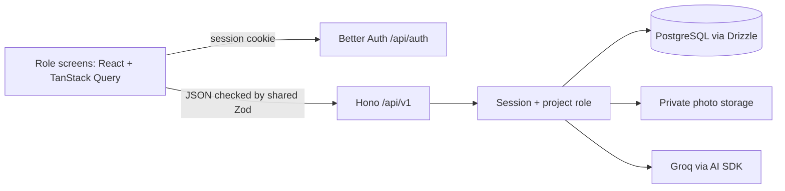

# Slate dev handbook

Everything needed to run, inspect, demo and share Slate, plus every API input and output. No secrets
live here: real values stay in your ignored `.env`.

## 1. Tech stack and why

One TypeScript codebase: the screens, the API and the database code live in one Next.js app, and one
set of Zod schemas describes every request and response on both sides.



| Layer | What we use | Why |
|---|---|---|
| App framework | Next.js 16.4 (App Router), React 19.3 | One app and one deploy serves both the screens and the API. Each role's pages are plain folders under `src/app/projects/[id]`. |
| API | Hono 4 mounted at `/api/v1`, `@hono/zod-openapi` | A small, fast router with middleware for sign-in and project-role checks. Routes are declared with Zod, which validates input and publishes the OpenAPI document at `/api/v1/doc` (this handbook's endpoint list comes from it). |
| Contract | Zod 4 in `src/shared/schemas` | The browser and server import the same schemas. The frontend parses every response with them, so a mismatch fails loudly instead of showing wrong numbers. |
| Database | PostgreSQL 16 in Docker | Transactions and row locks keep stock, wages and payments consistent when two people save at once. Money is integer paise; ledgers are append-only and corrected by adjustments. |
| Data access | Drizzle ORM 0.45, drizzle-kit, `postgres` driver | Typed queries that stay close to SQL, reviewable SQL migrations in `src/db/migrations`, and Drizzle Studio to browse the data. |
| Sign-in | Better Auth 1.7 | Email and password with an httpOnly session cookie, stored in the same database. Open sign-up is off; only invited emails can create accounts. |
| Server data in the UI | TanStack Query 5 | Caches each project's data, refreshes it after every save and every 10 s, so one person's change reaches everyone's open screen. |
| UI | Tailwind CSS 4, shadcn on Radix UI, lucide icons, sonner toasts, next-themes | Accessible building blocks (sheets, dialogs, focus handling) styled with our own light and dark tokens. Type is Newsreader for headings and Geist for text. |
| Charts | Recharts 3 | The stock and spend area charts. |
| AI | Vercel AI SDK 7 with Groq (`openai/gpt-oss-120b`) | One API for several providers (Groq, Gemini, NVIDIA, any OpenAI-compatible endpoint), switched by `.env`. Groq answers in about a second. |
| Revit import | fflate | An .xlsx is a zip of XML files, so a tiny unzip library reads it in the browser; no large spreadsheet package. |
| Files | sharp, pdfkit | sharp checks and decodes uploaded photos on the server; pdfkit renders the wage sheet PDF. |
| Quality | TypeScript 5, Biome 2, Vitest 5, Playwright | Types across the stack; Biome lints and formats in one fast tool; Vitest runs unit tests and API tests against a throwaway database; Playwright drives real browsers. |
| Tooling | pnpm 12 via Corepack, Node 22 or newer, tsx | Pinned package manager and a strict lockfile, so every laptop installs the same versions. tsx runs TypeScript scripts such as the seed. |
| Running and sharing | Docker Compose, cloudflared | One command starts PostgreSQL. A Cloudflare quick tunnel shares a running copy with other laptops without deploying or opening ports. |

## 2. Run it

```bash
corepack pnpm install --frozen-lockfile
cp .env.example .env            # then fill in the values (section 3)
docker compose up -d db         # local PostgreSQL (container slate-db-1)
SLATE_MIGRATION_DATABASE=slate_demo pnpm db:migrate
pnpm db:seed                    # demo accounts and the Greenfield Home project
pnpm dev                        # http://localhost:3000
```

| Command | Does |
|---|---|
| `pnpm dev` | Dev server on :3000 (`pnpm dev:lan` listens on your LAN too) |
| `pnpm build` / `pnpm start` | Production build / serve it |
| `pnpm lint` · `pnpm typecheck` · `pnpm test` | Biome, TypeScript, Vitest |
| `pnpm db:migrate` | Apply `src/db/migrations` (needs `SLATE_MIGRATION_DATABASE` = the database name in `DATABASE_URL`) |
| `pnpm db:generate` | New migration from `src/db/schema.ts` changes |
| `pnpm db:seed` | Demo data (idempotent) |
| `pnpm db:studio` | Drizzle Studio (section 5) |
| `./share.sh` | Share over a Cloudflare tunnel (section 7) |

API tests (`tests/api`) need `SLATE_TEST_DATABASE=1` and a loopback database named `slate_test…`; CI provides one.

## 3. Settings (`.env`)

| Variable | What |
|---|---|
| `DATABASE_URL` | `postgres://slate:<password>@127.0.0.1:5432/slate_demo` |
| `POSTGRES_PASSWORD`, `POSTGRES_DB`, `DB_PORT` | Compose database |
| `SLATE_MIGRATION_DATABASE` | Must equal the database name before `db:migrate` runs |
| `BETTER_AUTH_SECRET` | `openssl rand -base64 32` |
| `BETTER_AUTH_URL` | The one origin sign-in accepts, e.g. `http://localhost:3000`. `share.sh` swaps it for the tunnel address |
| `SLATE_DEMO_SEED`, `SLATE_DEMO_PASSWORD` | Seed switch and the demo accounts' password (8–64 characters). Change it and restart the server (or run `pnpm db:seed`): the demo accounts follow it |
| `UPLOAD_DIR` | Private folder for uploaded photos |
| `NEXT_PUBLIC_USE_MOCKS` | `0` = live database, `1` = in-browser demo data (dev only) |
| `AI_PROVIDER`, `AI_MODEL`, `AI_API_KEY`, `AI_BASE_URL` | Ask Slate and AI checklists (section 6) |

## 4. Accounts, roles and screens

Demo accounts: `owner@demo.invalid`, `contractor@demo.invalid`, `engineer@demo.invalid`; password is
`SLATE_DEMO_PASSWORD`. New people join by invitation: the engineer invites an email on **Team**, the
person picks **Invited? Create your account** on `/login`, signs up, then accepts on **Projects**.

| Role | Sees and does |
|---|---|
| Engineer | The only role that starts projects; **Set up the project** on home (Revit .xlsx import, add material, write checklist); reviews tasks; verifies deliveries; invites on Team; no wage amounts |
| Contractor | **Today** (delivery, usage, attendance, Fix); **Stock**; **Wages** (pay, add/remove workers); works checklist tasks. Cannot start projects |
| Owner | Home (budget, spend, approvals with a note); **Money** (suppliers, orders, mock payments, autopay); **Logs**. Cannot start projects |

Walkthroughs for both demos (seeded project, new project) are in [DEMO.md](DEMO.md).

**Revit import format:** sheet 1, a header row `Category | Level | Type | Count | Quantity | Unit` in
columns A–F; rows without a category (titles, subtotals) are skipped. One material per category and
unit. The `.rvt` file itself is not read.

## 5. Database

- **Drizzle Studio:** `pnpm db:studio`, then open <https://local.drizzle.studio>. It reads `DATABASE_URL`
  from `.env`; browse and edit every table. Close it with Ctrl+C.
- **psql:** `docker exec -it slate-db-1 psql -U slate -d slate_demo`
  - `\dt` lists tables; `select count(*) from projects;`
  - row counts: `select relname, n_live_tup from pg_stat_user_tables order by 1;`
- Schema: `src/db/schema.ts` (app) and `src/db/auth-schema.ts` (Better Auth: user, session, account).
- Money is integer **paise**; quantities have at most 3 decimals; dates are IST `YYYY-MM-DD`.
- Ledgers are append-only: fix a wrong entry with an adjustment (`POST /projects/{id}/adjustments`), never an edit.

## 6. AI (Ask Slate, checklists)

`.env`: `AI_PROVIDER=groq`, `AI_MODEL=openai/gpt-oss-120b`, `AI_API_KEY=<your Groq key>`. Without
`AI_MODEL` or the key, Ask Slate replies `{ "source": "offline" }` and checklists use the template.
List the models your key can use:

```bash
curl -s https://api.groq.com/openai/v1/models -H "Authorization: Bearer $AI_API_KEY"
```

Ask Slate answers in under about 80 words and declines anything off-topic. It cannot see project
records and points to the right screen instead. Concrete and brick-wall quantities come from two
deterministic server calculators (`src/server/ai/calculations.ts`: dry-volume factor 1.54 for
concrete, 1.33 for mortar, 50 kg bag = 0.035 m³); the model only reports their numbers. Limits: 10
questions per user per minute, 20 s timeout. Answers are not engineering sign-off.

## 7. Share with other laptops (Cloudflare tunnel)

```bash
./share.sh            # add --build after code changes
```

It builds if needed, serves production on :3100, opens a free `https://….trycloudflare.com` tunnel
and prints the address. Anyone with the link can use it from any laptop or phone; sign in there,
not on localhost. Ctrl+C stops both. The address changes every run, and data stays in your local
database, so your machine must stay on.

Install `cloudflared` once (no sudo):

```bash
curl -L -o ~/.local/bin/cloudflared https://github.com/cloudflare/cloudflared/releases/latest/download/cloudflared-linux-amd64
chmod +x ~/.local/bin/cloudflared
```

To run Slate *on* another laptop instead, clone the repo there and follow section 2 with its own
`.env` and database.

## 8. API conventions

- Base: `/api/v1`. Auth: Better Auth at `/api/auth` (`POST /api/auth/sign-in/email` with
  `{ email, password }`, `POST /api/auth/sign-out`). Sessions are an httpOnly cookie; send an `Origin`
  header equal to `BETTER_AUTH_URL` on auth calls.
- Every error: `{ "error": { "code", "message", "details"? } }`. Codes: `VALIDATION_ERROR` (400),
  `UNAUTHENTICATED` (401), `FORBIDDEN` (403), `NOT_FOUND` (404, also for projects you are not in),
  `CONFLICT` (409), `INSUFFICIENT_STOCK`, `DUPLICATE_CHALLAN`, `INTERNAL`.
- Who may call each route: the table in [API.md](API.md). Live OpenAPI JSON: `GET /api/v1/doc`.
- `?` marks an optional field. Regenerate the reference below after API changes:
  `curl -s localhost:3000/api/v1/doc > /tmp/openapi.json && python3 scripts/api-reference.py /tmp/openapi.json`

### Quick try

```bash
B=http://localhost:3000
curl -c jar -H "origin: $B" -H 'content-type: application/json' \
  -d '{"email":"owner@demo.invalid","password":"<SLATE_DEMO_PASSWORD>"}' $B/api/auth/sign-in/email
curl -b jar $B/api/v1/projects
```

## 9. Every endpoint: inputs and outputs

#### `POST /invitations/signup`
- **Body** (JSON): { email: string, name: string, password: string }
- **201**: { created: `true` }
- **Errors:** 400, 409, 500

#### `POST /projects`
- **Body** (JSON): { name: string, location: string, startDate: string, budgetPaise: integer }
- **201**: { id: string, name: string, location: string, startDate: string, budgetPaise: integer, role: `owner` \| `contractor` \| `engineer` }
- **Errors:** 400, 401, 403, 404, 500

#### `GET /projects`
- **200**: array of { id: string, name: string, location: string, startDate: string, budgetPaise: integer, role: `owner` \| `contractor` \| `engineer` }
- **Errors:** 400, 401, 403, 404, 500

#### `GET /projects/{id}`
- **200**: { id: string, name: string, location: string, startDate: string, budgetPaise: integer, role: `owner` \| `contractor` \| `engineer` }
- **Errors:** 400, 401, 403, 404, 500

#### `POST /projects/{id}/members`
- **Body** (JSON): { email: string, role: `owner` \| `engineer` }
- **201**: { userId: string, role: `owner` \| `contractor` \| `engineer` }
- **Errors:** 400, 401, 403, 404, 409, 500

#### `GET /projects/{id}/members`
- **200**: array of { userId: string, role: `owner` \| `contractor` \| `engineer`, name: string, phone?: string }
- **Errors:** 400, 401, 403, 404, 500

#### `POST /projects/{id}/invitations`
- **Body** (JSON): { email: string, role: `owner` \| `contractor` } **or** { phone: string, role: `owner` \| `contractor` }
- **201**: { id: string, projectId: string, projectName: string, role: `owner` \| `contractor`, createdAt: string, status: `pending` \| `accepted`, email: string } **or** { id: string, projectId: string, projectName: string, role: `owner` \| `contractor`, createdAt: string, status: `pending` \| `accepted`, phone: string }
- **Errors:** 400, 401, 403, 404, 409, 500

#### `GET /projects/{id}/invitations`
- **Query:** status?: `pending` \| `accepted`
- **200**: array of { id: string, projectId: string, projectName: string, role: `owner` \| `contractor`, createdAt: string, status: `pending` \| `accepted`, email: string } **or** { id: string, projectId: string, projectName: string, role: `owner` \| `contractor`, createdAt: string, status: `pending` \| `accepted`, phone: string }
- **Errors:** 400, 401, 403, 404, 500

#### `GET /invitations`
- **200**: array of { id: string, projectId: string, projectName: string, role: `owner` \| `contractor`, createdAt: string, status: `pending` \| `accepted`, email: string } **or** { id: string, projectId: string, projectName: string, role: `owner` \| `contractor`, createdAt: string, status: `pending` \| `accepted`, phone: string }
- **Errors:** 400, 401, 403, 404, 500

#### `POST /invitations/{id}/accept`
- **200**: { userId: string, role: `owner` \| `contractor` \| `engineer` }
- **Errors:** 400, 401, 403, 404, 409, 500

#### `GET /me/permissions`
- **200**: { canCreateProjects: boolean }
- **Errors:** 400, 401, 403, 404, 500

#### `PATCH /me`
- **Body** (JSON): { phone: string }
- **200**: { phone: string }
- **Errors:** 400, 401, 403, 404, 500

#### `POST /projects/{id}/materials`
- **Body** (JSON): { name: string, unit: string, plannedQty: number, unitCostPaise: integer, tolerancePct: number, lowStockQty: number, tracksBags?: boolean }
- **201**: { id: string, name: string, unit: string, plannedQty: number, unitCostPaise: integer, tolerancePct: number, lowStockQty: number, tracksBags?: boolean }
- **Errors:** 400, 401, 403, 404, 500

#### `GET /projects/{id}/materials`
- **200**: array of { id: string, name: string, unit: string, plannedQty: number, unitCostPaise: integer, tolerancePct: number, lowStockQty: number, tracksBags?: boolean }
- **Errors:** 400, 401, 403, 404, 500

#### `POST /projects/{id}/workers`
- **Body** (JSON): { name: string, category: string, dailyRatePaise: integer }
- **201**: { id: string, name: string, category: string, dailyRatePaise: integer, active: boolean, removedReason?: string, removedOn?: string }
- **Errors:** 400, 401, 403, 404, 500

#### `GET /projects/{id}/workers`
- **200**: array of { id: string, name: string, category: string, dailyRatePaise: integer, active: boolean, removedReason?: string, removedOn?: string }
- **Errors:** 400, 401, 403, 404, 500

#### `POST /projects/{id}/workers/{workerId}/deactivate`
- **Body** (JSON): { reason: string }
- **200**: { id: string, name: string, category: string, dailyRatePaise: integer, active: boolean, removedReason?: string, removedOn?: string }
- **Errors:** 400, 401, 403, 404, 409, 500

#### `POST /projects/{id}/deliveries`
- **Body** (JSON): { materialId: string, qty: number, unitCostPaise: integer, supplier: string, challanNo: string, occurredOn: string, note: string }
- **201**: { id: string, materialId: string, qty: number, unitCostPaise: integer, supplier: string, challanNo: string, occurredOn: string, note: string, balance: number }
- **Errors:** 400, 401, 403, 404, 409, 500

#### `POST /projects/{id}/expected-deliveries`
- **Body** (JSON): { materialId: string, qty: number, supplier: string, expectedOn: string, note?: string }
- **201**: { materialId: string, qty: number, supplier: string, expectedOn: string, note: string, id: string, status: `pending` \| `accepted` \| `rejected`, deliveryId: string, rejectionReason: string, rescheduledOn: string, decidedAt: string, createdAt: string }
- **Errors:** 400, 401, 403, 404, 500

#### `GET /projects/{id}/expected-deliveries`
- **Query:** status?: `pending` \| `accepted` \| `rejected` or `all`
- **200**: array of { materialId: string, qty: number, supplier: string, expectedOn: string, note: string, id: string, status: `pending` \| `accepted` \| `rejected`, deliveryId: string, rejectionReason: string, rescheduledOn: string, decidedAt: string, createdAt: string }
- **Errors:** 400, 401, 403, 404, 500

#### `POST /expected-deliveries/{id}/accept`
- **Body** (JSON): { materialId: string, qty: number, unitCostPaise: integer, supplier: string, challanNo: string, occurredOn: string, note: string }
- **201**: { id: string, materialId: string, qty: number, unitCostPaise: integer, supplier: string, challanNo: string, occurredOn: string, note: string, balance: number }
- **Errors:** 400, 401, 403, 404, 409, 500

#### `POST /expected-deliveries/{id}/reject`
- **Body** (JSON): { reason: string, newDate?: string }
- **200**: { materialId: string, qty: number, supplier: string, expectedOn: string, note: string, id: string, status: `pending` \| `accepted` \| `rejected`, deliveryId: string, rejectionReason: string, rescheduledOn: string, decidedAt: string, createdAt: string }
- **Errors:** 400, 401, 403, 404, 409, 500

#### `POST /projects/{id}/deliveries/{deliveryId}/challan-photo`
- **Body** (multipart): { photo: file, capturedAt: string }
- **201**: { mime: `image/jpeg` \| `image/png` \| `image/webp`, sizeBytes: integer, capturedAt?: string, receivedAt?: string, url: string, deliveryId: string, createdAt: string }
- **Errors:** 400, 401, 403, 404, 409, 413, 500

#### `GET /projects/{id}/deliveries/{deliveryId}/challan-photo`
- **200** (image/jpeg): Private challan photo bytes
- **Errors:** 400, 401, 403, 404, 500

#### `GET /projects/{id}/deliveries-to-verify`
- **200**: array of { deliveryId: string, materialName: string, unit: string, qty: number, supplier: string, challanNo: string, occurredOn: string, tracksBags: boolean }
- **Errors:** 400, 401, 403, 404, 500

#### `POST /projects/{id}/deliveries/{deliveryId}/verify`
- **Body** (JSON): { note: string, codes?: string[] }
- **200**: { ok: `true`, deliveryId: string, verifiedBy: string, verifiedAt: string, bagCodeCount: integer }
- **Errors:** 400, 401, 403, 404, 409, 500

#### `POST /deliveries/{id}/bag-codes`
- **Body** (JSON): { codes: string[], note?: string }
- **200**: { ok: `true`, deliveryId: string, verifiedBy: string, verifiedAt: string, bagCodeCount: integer }
- **Errors:** 400, 401, 403, 404, 409, 500

#### `POST /projects/{id}/usages`
- **Body** (JSON): { materialId: string, qty: number, occurredOn: string, note: string, bagCodes?: string[] }
- **201**: { id: string, materialId: string, qty: number, occurredOn: string, note: string, balance: number }
- **Errors:** 400, 401, 403, 404, 409, 500

#### `GET /projects/{id}/stock`
- **200**: array of { materialId: string, name: string, unit: string, balance: number, lowStockQty: number, lowStock: boolean }
- **Errors:** 400, 401, 403, 404, 500

#### `GET /projects/{id}/movements`
- **Query:** materialId?: string
- **200**: array of { id: string, materialId: string, occurredOn: string, createdAt: string, note: string, type: `delivery`, qty: number, supplier: string, challanNo: string, unitCostPaise: integer } **or** { id: string, materialId: string, occurredOn: string, createdAt: string, note: string, type: `usage`, qty: number } **or** { id: string, materialId: string, occurredOn: string, createdAt: string, note: string, type: `adjustment`, qty: number }
- **Errors:** 400, 401, 403, 404, 500

#### `GET /health`
- **200**: { ok: boolean, db: `up` \| `down` }

#### `POST /projects/{id}/attendance`
- **Body** (JSON): { workDate: string, entries: object[] }
- **201**: { workDate: string, entries: object[] }
- **Errors:** 400, 401, 403, 404, 409, 500

#### `GET /projects/{id}/attendance`
- **Query:** from?: string, to?: string, workerId?: string
- **200**: array of { id: string, workerId: string, workDate: string, halfDays: `0` or `1` or `2`, effectiveHalfDays: `0` or `1` or `2`, ratePaise: integer, createdAt: string }
- **Errors:** 400, 401, 403, 404, 500

#### `GET /projects/{id}/attendance/roster`
- **Query:** from?: string, to?: string, workerId?: string
- **200**: array of { id: string, workerId: string, workerName: string, workDate: string, effectiveHalfDays: `0` or `1` or `2` }
- **Errors:** 400, 401, 403, 404, 500

#### `POST /projects/{id}/change-requests`
- **Body** (JSON): { kind: `checklist_add`, payload: object, note: string } **or** { kind: `checklist_rename`, targetId: string, payload: object, note: string } **or** { kind: `checklist_remove`, targetId: string, payload: object, note: string } **or** { kind: `attendance_fix`, targetId: string, payload: object, note: string }
- **201**: { kind: `checklist_add`, payload: object, id: string, projectId: string, authorId: string, authorRole: `engineer` \| `contractor`, status: `pending_contractor` \| `pending_owner` \| `rejected_contractor` \| `accepted` \| `rejected_owner`, events: object[] } **or** { kind: `checklist_rename`, targetId: string, payload: object, id: string, projectId: string, authorId: string, authorRole: `engineer` \| `contractor`, status: `pending_contractor` \| `pending_owner` \| `rejected_contractor` \| `accepted` \| `rejected_owner`, events: object[] } **or** { kind: `checklist_remove`, targetId: string, payload: object, id: string, projectId: string, authorId: string, authorRole: `engineer` \| `contractor`, status: `pending_contractor` \| `pending_owner` \| `rejected_contractor` \| `accepted` \| `rejected_owner`, events: object[] } **or** { kind: `attendance_fix`, targetId: string, payload: object, id: string, projectId: string, authorId: string, authorRole: `engineer` \| `contractor`, status: `pending_contractor` \| `pending_owner` \| `rejected_contractor` \| `accepted` \| `rejected_owner`, events: object[] } **or** { id: string, projectId: string, authorId: string, authorRole: `engineer` \| `contractor`, status: `pending_contractor` \| `pending_owner` \| `rejected_contractor` \| `accepted` \| `rejected_owner`, events: object[], kind: `medical_expense`, payload: object, payPaise: integer, reimbursementProvider?: `mock` }
- **Errors:** 400, 401, 403, 404, 409, 500

#### `GET /projects/{id}/change-requests`
- **Query:** status?: `pending_contractor` \| `pending_owner` \| `rejected_contractor` \| `accepted` \| `rejected_owner`
- **200**: array of { kind: `checklist_add`, payload: object, id: string, projectId: string, authorId: string, authorRole: `engineer` \| `contractor`, status: `pending_contractor` \| `pending_owner` \| `rejected_contractor` \| `accepted` \| `rejected_owner`, events: object[] } **or** { kind: `checklist_rename`, targetId: string, payload: object, id: string, projectId: string, authorId: string, authorRole: `engineer` \| `contractor`, status: `pending_contractor` \| `pending_owner` \| `rejected_contractor` \| `accepted` \| `rejected_owner`, events: object[] } **or** { kind: `checklist_remove`, targetId: string, payload: object, id: string, projectId: string, authorId: string, authorRole: `engineer` \| `contractor`, status: `pending_contractor` \| `pending_owner` \| `rejected_contractor` \| `accepted` \| `rejected_owner`, events: object[] } **or** { kind: `attendance_fix`, targetId: string, payload: object, id: string, projectId: string, authorId: string, authorRole: `engineer` \| `contractor`, status: `pending_contractor` \| `pending_owner` \| `rejected_contractor` \| `accepted` \| `rejected_owner`, events: object[] } **or** { id: string, projectId: string, authorId: string, authorRole: `engineer` \| `contractor`, status: `pending_contractor` \| `pending_owner` \| `rejected_contractor` \| `accepted` \| `rejected_owner`, events: object[], kind: `medical_expense`, payload: object, payPaise: integer, reimbursementProvider?: `mock` }
- **Errors:** 400, 401, 403, 404, 409, 500

#### `POST /change-requests/{id}/vote`
- **Body** (JSON): { approve: boolean, note: string }
- **200**: { kind: `checklist_add`, payload: object, id: string, projectId: string, authorId: string, authorRole: `engineer` \| `contractor`, status: `pending_contractor` \| `pending_owner` \| `rejected_contractor` \| `accepted` \| `rejected_owner`, events: object[] } **or** { kind: `checklist_rename`, targetId: string, payload: object, id: string, projectId: string, authorId: string, authorRole: `engineer` \| `contractor`, status: `pending_contractor` \| `pending_owner` \| `rejected_contractor` \| `accepted` \| `rejected_owner`, events: object[] } **or** { kind: `checklist_remove`, targetId: string, payload: object, id: string, projectId: string, authorId: string, authorRole: `engineer` \| `contractor`, status: `pending_contractor` \| `pending_owner` \| `rejected_contractor` \| `accepted` \| `rejected_owner`, events: object[] } **or** { kind: `attendance_fix`, targetId: string, payload: object, id: string, projectId: string, authorId: string, authorRole: `engineer` \| `contractor`, status: `pending_contractor` \| `pending_owner` \| `rejected_contractor` \| `accepted` \| `rejected_owner`, events: object[] } **or** { id: string, projectId: string, authorId: string, authorRole: `engineer` \| `contractor`, status: `pending_contractor` \| `pending_owner` \| `rejected_contractor` \| `accepted` \| `rejected_owner`, events: object[], kind: `medical_expense`, payload: object, payPaise: integer, reimbursementProvider?: `mock` }
- **Errors:** 400, 401, 403, 404, 409, 500

#### `POST /change-requests/{id}/reopen`
- **Body** (JSON): { note: string }
- **200**: { kind: `checklist_add`, payload: object, id: string, projectId: string, authorId: string, authorRole: `engineer` \| `contractor`, status: `pending_contractor` \| `pending_owner` \| `rejected_contractor` \| `accepted` \| `rejected_owner`, events: object[] } **or** { kind: `checklist_rename`, targetId: string, payload: object, id: string, projectId: string, authorId: string, authorRole: `engineer` \| `contractor`, status: `pending_contractor` \| `pending_owner` \| `rejected_contractor` \| `accepted` \| `rejected_owner`, events: object[] } **or** { kind: `checklist_remove`, targetId: string, payload: object, id: string, projectId: string, authorId: string, authorRole: `engineer` \| `contractor`, status: `pending_contractor` \| `pending_owner` \| `rejected_contractor` \| `accepted` \| `rejected_owner`, events: object[] } **or** { kind: `attendance_fix`, targetId: string, payload: object, id: string, projectId: string, authorId: string, authorRole: `engineer` \| `contractor`, status: `pending_contractor` \| `pending_owner` \| `rejected_contractor` \| `accepted` \| `rejected_owner`, events: object[] } **or** { id: string, projectId: string, authorId: string, authorRole: `engineer` \| `contractor`, status: `pending_contractor` \| `pending_owner` \| `rejected_contractor` \| `accepted` \| `rejected_owner`, events: object[], kind: `medical_expense`, payload: object, payPaise: integer, reimbursementProvider?: `mock` }
- **Errors:** 400, 401, 403, 404, 409, 500

#### `POST /change-requests/{id}/decision`
- **Body** (JSON): { accept: `true`, note: string, payPaise?: integer } **or** { accept: `false`, note: string }
- **200**: { kind: `checklist_add`, payload: object, id: string, projectId: string, authorId: string, authorRole: `engineer` \| `contractor`, status: `pending_contractor` \| `pending_owner` \| `rejected_contractor` \| `accepted` \| `rejected_owner`, events: object[] } **or** { kind: `checklist_rename`, targetId: string, payload: object, id: string, projectId: string, authorId: string, authorRole: `engineer` \| `contractor`, status: `pending_contractor` \| `pending_owner` \| `rejected_contractor` \| `accepted` \| `rejected_owner`, events: object[] } **or** { kind: `checklist_remove`, targetId: string, payload: object, id: string, projectId: string, authorId: string, authorRole: `engineer` \| `contractor`, status: `pending_contractor` \| `pending_owner` \| `rejected_contractor` \| `accepted` \| `rejected_owner`, events: object[] } **or** { kind: `attendance_fix`, targetId: string, payload: object, id: string, projectId: string, authorId: string, authorRole: `engineer` \| `contractor`, status: `pending_contractor` \| `pending_owner` \| `rejected_contractor` \| `accepted` \| `rejected_owner`, events: object[] } **or** { id: string, projectId: string, authorId: string, authorRole: `engineer` \| `contractor`, status: `pending_contractor` \| `pending_owner` \| `rejected_contractor` \| `accepted` \| `rejected_owner`, events: object[], kind: `medical_expense`, payload: object, payPaise: integer, reimbursementProvider?: `mock` }
- **Errors:** 400, 401, 403, 404, 409, 500

#### `POST /projects/{id}/medical-expenses`
- **Body** (multipart): { workerId: string, billPaise: string, incidentOn: string, note: string, billPhotos: file or file[], capturedAt: string or string[] }
- **201**: { kind: `checklist_add`, payload: object, id: string, projectId: string, authorId: string, authorRole: `engineer` \| `contractor`, status: `pending_contractor` \| `pending_owner` \| `rejected_contractor` \| `accepted` \| `rejected_owner`, events: object[] } **or** { kind: `checklist_rename`, targetId: string, payload: object, id: string, projectId: string, authorId: string, authorRole: `engineer` \| `contractor`, status: `pending_contractor` \| `pending_owner` \| `rejected_contractor` \| `accepted` \| `rejected_owner`, events: object[] } **or** { kind: `checklist_remove`, targetId: string, payload: object, id: string, projectId: string, authorId: string, authorRole: `engineer` \| `contractor`, status: `pending_contractor` \| `pending_owner` \| `rejected_contractor` \| `accepted` \| `rejected_owner`, events: object[] } **or** { kind: `attendance_fix`, targetId: string, payload: object, id: string, projectId: string, authorId: string, authorRole: `engineer` \| `contractor`, status: `pending_contractor` \| `pending_owner` \| `rejected_contractor` \| `accepted` \| `rejected_owner`, events: object[] } **or** { id: string, projectId: string, authorId: string, authorRole: `engineer` \| `contractor`, status: `pending_contractor` \| `pending_owner` \| `rejected_contractor` \| `accepted` \| `rejected_owner`, events: object[], kind: `medical_expense`, payload: object, payPaise: integer, reimbursementProvider?: `mock` }
- **Errors:** 400, 401, 403, 404, 409, 413, 500

#### `GET /projects/{id}/medical-expenses/{requestId}/photos/{photoId}`
- **200** (image/jpeg): Protected bill image
- **Errors:** 400, 401, 403, 404, 409, 500

#### `POST /projects/{id}/wage-payments`
- **Body** (JSON): { workerId: string, amountPaise: integer, kind: `wage` \| `advance`, mode: `cash` \| `upi` \| `bank` \| `cheque`, paidOn: string, note: string, reference?: string }
- **201**: { id: string, workerId: string, amountPaise: integer, kind: `wage` \| `advance`, mode: `cash` \| `upi` \| `bank` \| `cheque`, paidOn: string, reference: string, note?: string }
- **Errors:** 400, 401, 403, 404, 500

#### `GET /projects/{id}/wage-payments`
- **Query:** from?: string, to?: string, workerId?: string
- **200**: array of { id: string, workerId: string, amountPaise: integer, kind: `wage` \| `advance`, mode: `cash` \| `upi` \| `bank` \| `cheque`, paidOn: string, reference: string, note?: string, effectiveAmountPaise: integer, createdAt: string }
- **Errors:** 400, 401, 403, 404, 500

#### `POST /projects/{id}/adjustments`
- **Body** (JSON): { targetId: string, reason: string, targetTable: `stock_movements`, newValue: number } **or** { targetId: string, reason: string, targetTable: `attendance`, newValue: `0` or `1` or `2` } **or** { targetId: string, reason: string, targetTable: `wage_payments`, newValue: integer }
- **201**: { targetId: string, reason: string, id: string, createdAt: string, actorId: string, targetTable: `stock_movements`, oldValue: number, newValue: number } **or** { targetId: string, reason: string, id: string, createdAt: string, actorId: string, targetTable: `attendance`, oldValue: `0` or `1` or `2`, newValue: `0` or `1` or `2` } **or** { targetId: string, reason: string, id: string, createdAt: string, actorId: string, targetTable: `wage_payments`, oldValue: integer, newValue: integer }
- **Errors:** 400, 401, 403, 404, 409, 500

#### `GET /projects/{id}/adjustments`
- **Query:** from?: string, to?: string, targetTable?: `stock_movements` \| `attendance` \| `wage_payments`, targetId?: string
- **200**: array of { targetId: string, reason: string, id: string, createdAt: string, actorId: string, targetTable: `stock_movements`, oldValue: number, newValue: number } **or** { targetId: string, reason: string, id: string, createdAt: string, actorId: string, targetTable: `attendance`, oldValue: `0` or `1` or `2`, newValue: `0` or `1` or `2` } **or** { targetId: string, reason: string, id: string, createdAt: string, actorId: string, targetTable: `wage_payments`, oldValue: integer, newValue: integer }
- **Errors:** 400, 401, 403, 404, 500

#### `GET /projects/{id}/summary`
- **200**: { budgetPaise: integer, spendPaise: integer, burnRatePaisePerDay: integer, materialVariance: object[], stockAlerts: object[], role: `engineer`, spendByWeek: object[] } **or** { budgetPaise: integer, spendPaise: integer, burnRatePaisePerDay: integer, materialVariance: object[], stockAlerts: object[], role: `contractor`, spendSplit: object, spendByWeek: object[] } **or** { budgetPaise: integer, spendPaise: integer, burnRatePaisePerDay: integer, materialVariance: object[], stockAlerts: object[], role: `owner`, spendSplit: object, spendByWeek: object[], fraudFlags?: object[] }
- **Errors:** 400, 401, 403, 404, 409, 500

#### `GET /projects/{id}/suppliers`
- **200**: array of { id: string, name: string, gstin: string, accountLast4: string, approved: boolean, autopay: object, bankChange: object }
- **Errors:** 400, 401, 403, 404, 409, 500

#### `POST /projects/{id}/suppliers`
- **Body** (JSON): { note: string, name: string, gstin: string, account: string }
- **201**: { ok: `true`, provider: `mock` }
- **Errors:** 400, 401, 403, 404, 409, 500

#### `POST /suppliers/{id}/approve`
- **Body** (JSON): { note: string }
- **200**: { ok: `true`, provider: `mock` }
- **Errors:** 400, 401, 403, 404, 409, 500

#### `POST /suppliers/{id}/bank-change`
- **Body** (JSON): { note: string, account: string }
- **200**: { ok: `true`, provider: `mock` }
- **Errors:** 400, 401, 403, 404, 409, 500

#### `POST /suppliers/{id}/bank-change/approve`
- **Body** (JSON): { note: string }
- **200**: { ok: `true`, provider: `mock` }
- **Errors:** 400, 401, 403, 404, 409, 500

#### `PUT /suppliers/{id}/autopay`
- **Body** (JSON): { enabled: boolean, paused: boolean, perBillCapPaise: integer, perWeekCapPaise: integer, note: string }
- **200**: { ok: `true`, provider: `mock` }
- **Errors:** 400, 401, 403, 404, 409, 500

#### `PUT /projects/{id}/autopay`
- **Body** (JSON): { note: string, paused: boolean }
- **200**: { ok: `true`, provider: `mock` }
- **Errors:** 400, 401, 403, 404, 409, 500

#### `POST /projects/{id}/orders`
- **Body** (JSON): { note: string, supplierId: string, materialId: string, qty: number, maxUnitPricePaise: integer }
- **201**: { ok: `true`, provider: `mock` }
- **Errors:** 400, 401, 403, 404, 409, 500

#### `GET /projects/{id}/supplier-payments`
- **Query:** status?: `pending` \| `paid` \| `declined`
- **200**: { provider: `mock`, paused: boolean, suppliers: object[], orders: object[], payments: object[] }
- **Errors:** 400, 401, 403, 404, 409, 500

#### `GET /projects/{id}/payments`
- **Query:** status?: `pending` \| `paid` \| `declined`
- **200**: array of { provider: `mock`, id: string, deliveryId: string, supplierName: string, materialId: string, qty: number, unitPricePaise: integer, occurredOn: string, verifiedNote: string, status: `pending` \| `paid` \| `declined`, amountPaise: integer, heldBecause: string, paidBy: `autopay` \| `owner` \| `null`, decidedAt: string, decisionNote: string }
- **Errors:** 400, 401, 403, 404, 409, 500

#### `POST /supplier-payments/{id}/decision`
- **Body** (JSON): { note: string, approve: boolean }
- **200**: { ok: `true`, provider: `mock` }
- **Errors:** 400, 401, 403, 404, 409, 500

#### `POST /payments/approve`
- **Body** (JSON): { note: string, ids: string[] }
- **200**: { ok: `true`, provider: `mock` }
- **Errors:** 400, 401, 403, 404, 409, 500

#### `GET /projects/{id}/wage-sheet`
- **Query:** from: string, to: string, format?: `json` \| `csv` \| `pdf`
- **200**: { from: string, to: string, workers: object[], totals: object }
- **Errors:** 400, 401, 403, 404, 500

#### `POST /projects/{id}/progress`
- **Body** (multipart): { note: string, checklistItemId?: string, photos: file or file[], capturedAt: string or string[] }
- **201**: { id: string, note: string, checklistItemId: string, createdAt: string, photos: object[] }
- **Errors:** 400, 401, 403, 404, 409, 413, 500

#### `GET /projects/{id}/timeline`
- **200**: array of { date: string, updates: object[] }
- **Errors:** 400, 401, 403, 404, 500

#### `GET /projects/{id}/photos/{photoId}`
- **200** (image/jpeg): Protected image bytes
- **Errors:** 400, 401, 403, 404, 500

#### `POST /projects/{id}/proposals`
- **Body** (JSON): { title: string, description: string, costImpactPaise: integer }
- **201**: { title: string, description: string, costImpactPaise: integer, id: string, createdAt: string, status: `pending`, decidedAt: any } **or** { title: string, description: string, costImpactPaise: integer, id: string, createdAt: string, status: `approved` \| `rejected`, decidedAt: string }
- **Errors:** 400, 401, 403, 404, 500

#### `GET /projects/{id}/proposals`
- **200**: array of { title: string, description: string, costImpactPaise: integer, id: string, createdAt: string, status: `pending`, decidedAt: any } **or** { title: string, description: string, costImpactPaise: integer, id: string, createdAt: string, status: `approved` \| `rejected`, decidedAt: string }
- **Errors:** 400, 401, 403, 404, 500

#### `POST /proposals/{id}/decision`
- **Body** (JSON): { decision: `approve` \| `reject`, note: string }
- **200**: { title: string, description: string, costImpactPaise: integer, id: string, createdAt: string, status: `pending`, decidedAt: any } **or** { title: string, description: string, costImpactPaise: integer, id: string, createdAt: string, status: `approved` \| `rejected`, decidedAt: string }
- **Errors:** 400, 401, 403, 404, 409, 500

#### `GET /projects/{id}/activity`
- **200**: array of { id: string, actor: object, action: `created` \| `updated` \| `corrected` \| `approved` \| `rejected`, entity: `project` \| `member` \| `material` \| `worker` \| `delivery` \| `expectedDelivery` \| `supplier` \| `supplierBankChange` \| `supplierOrder`, entityId: string, createdAt: string }
- **Errors:** 400, 401, 403, 404, 500

#### `POST /projects/{id}/checklists`
- **Query:** source: `template` \| `ai`
- **Body** (JSON): { houseType?: string, floors?: integer, rooms?: integer }
- **Body** (multipart): { houseType?: string, floors?: integer, rooms?: integer, plan?: file }
- **200**: { draftId: string, source: `template` \| `ai`, fallbackReason: `unavailable` \| `timeout` \| `invalidOutput` \| `null`, draft: object }
- **Errors:** 400, 401, 403, 404, 409, 413, 500

#### `GET /projects/{id}/checklists`
- **200**: array of { id: string, title: string, source: `template`, createdAt: string, items: object[] }
- **Errors:** 400, 401, 403, 404, 409, 500

#### `POST /projects/{id}/checklists/records`
- **Body** (JSON): { draftId: string, title: string, items: object[] }
- **201**: { id: string, title: string, source: `template`, createdAt: string, items: object[] }
- **Errors:** 400, 401, 403, 404, 409, 500

#### `POST /checklist-items/{id}/start`
- **200**: { phase: `foundation` \| `plinth` \| `walls` \| `slab` \| `plumbing` \| `electrical` \| `plaster` \| `flooring` \| `finishing`, task: string, materials: string[], requiresSteelProof?: boolean, id: string, status: `pending` \| `inProgress` \| `done`, verificationStatus: `todo` \| `doing` \| `waiting` \| `done` \| `sent_back`, removedAt: string, history: object[] }
- **Errors:** 400, 401, 403, 404, 409, 500

#### `POST /checklist-items/{id}/completion`
- **Body** (multipart): { note: string, photos: file or file[], capturedAt: string or string[] }
- **200**: { phase: `foundation` \| `plinth` \| `walls` \| `slab` \| `plumbing` \| `electrical` \| `plaster` \| `flooring` \| `finishing`, task: string, materials: string[], requiresSteelProof?: boolean, id: string, status: `pending` \| `inProgress` \| `done`, verificationStatus: `todo` \| `doing` \| `waiting` \| `done` \| `sent_back`, removedAt: string, history: object[] }
- **Errors:** 400, 401, 403, 404, 409, 413, 500

#### `POST /checklist-items/{id}/review`
- **Body** (JSON): { decision: `accept`, progressId: string, note: string } **or** { decision: `send_back`, progressId: string, note: string }
- **200**: { phase: `foundation` \| `plinth` \| `walls` \| `slab` \| `plumbing` \| `electrical` \| `plaster` \| `flooring` \| `finishing`, task: string, materials: string[], requiresSteelProof?: boolean, id: string, status: `pending` \| `inProgress` \| `done`, verificationStatus: `todo` \| `doing` \| `waiting` \| `done` \| `sent_back`, removedAt: string, history: object[] }
- **Errors:** 400, 401, 403, 404, 409, 500

#### `POST /checklist-items/{id}/steel-proof`
- **Body** (multipart): { progressId: string, note: string, photos: file or file[], capturedAt: string or string[] }
- **201**: array of { id: string, mime: `image/jpeg` \| `image/png` \| `image/webp`, sizeBytes: integer, takenOn: string, capturedAt: string, receivedAt: string, url: string, progressId: string }
- **Errors:** 400, 401, 403, 404, 409, 413, 500

#### `GET /checklist-items/{id}/steel-proof`
- **200**: array of { id: string, mime: `image/jpeg` \| `image/png` \| `image/webp`, sizeBytes: integer, takenOn: string, capturedAt: string, receivedAt: string, url: string, progressId: string }
- **Errors:** 400, 401, 403, 404, 409, 500

#### `GET /checklist-items/{id}/steel-proof/{photoId}`
- **200** (image/jpeg): Protected steel image
- **Errors:** 400, 401, 403, 404, 409, 500

#### `POST /projects/{id}/ai/calculate-materials`
- **Body** (JSON): { dimensions: object[], mixRatio: number[], wasteMarginPercent?: number }
- **200**: { source: `deterministic`, wetVolumeM3: number, cementBags50Kg: integer, sandM3: number, aggregateM3: number, assumptions: string[] }
- **Errors:** 400, 401, 403, 404, 413, 500

#### `POST /projects/{id}/ai/chat`
- **Body** (JSON): { messages: object[] }
- **200**: { source: `ai` \| `prototype`, reply: string } **or** { source: `offline`, message: string }
- **Errors:** 400, 401, 403, 404, 413, 429, 500, 503

